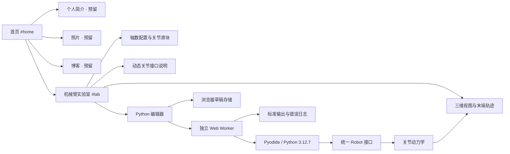

# YANN 个人网站与机械臂实验室

已实现可运行的静态网站：深色背景、橙色点缀、清晰留白，首页四个入口，机械臂实验室独立路由。个人简介、照片、博客保留入口并提示「正在准备」。

## 页面与模块



| 文件 | 职责 |
| --- | --- |
| `index.html` | 首页、实验室、导航、接口参考和说明弹窗 |
| `assets/css/site.css` | 全站设计样式与桌面、平板、手机布局 |
| `assets/js/app.js` | 路由、界面状态、编辑器、日志和 Worker 生命周期 |
| `assets/js/scene.js` | Three.js 场景、机械臂建模、相机、网格、阴影和轨迹 |
| `assets/js/physics.js` | 动态轴数、正运动学、重力、惯量、驱动、接触和状态快照 |
| `assets/js/python-worker.js` | Python 运行时、`arm.Robot` 接口、仿真调度和输出限流 |
| `assets/vendor/` | 固定版本的本地 Three.js、Pyodide 运行资源与许可证 |
| `tests/physics.test.js` | 动力学行为和接口约束验证 |
| `tests/browser.mjs` | 实际浏览器与 Python 执行、交互、响应式布局验证 |
| `letter.html` | 修改前首页的完整备份，保留原有内容与照片引用 |

网站使用原生 ES Modules，无构建步骤。渲染与手动控制在主线程执行；Python 在 Worker 中执行，长时间计算可以通过「停止」终止，不会直接阻塞编辑器。Python 运行与手动控制共享同一个动力学实现及状态结构。

## 运行

在项目目录执行：

```bash
npm run dev
```

打开 `http://localhost:5173`，机械臂实验室位于 `/#lab`。也可使用任意静态 HTTP 服务托管根目录。不能通过直接双击 HTML 启动 Python Worker。

渲染和 Python 资源都由本站提供，运行时不依赖第三方 CDN。Python 资源约 14 MB，首次启动需要加载；之后可由浏览器 HTTP 缓存复用。本版本内置 Python 标准库，不包含 NumPy 等额外包。

## 轴数与关节控制

轴数由输入框或 1、3、6、7 轴快捷按钮设置。输入任意正整数后，关节控制、接口参考、`Robot(dof=N)` 和 Demo 自动同步。每个轴数拥有独立的代码草稿，切换模型不会覆盖其他模型的草稿。

浏览器资源是有限的：目前为关节状态与桥接数据设置 32 MB 分配预算，按每轴 512 字节保守估算，允许最多 65,536 轴。超过预算、非整数和非有限数值都会明确报错。三维建模最多显示前 128 个关节；所有已创建关节仍参与接口与动力学计算，关节滑块每页显示 6 个。超出三维显示规模时页面会提示。高轴数会降低运行速度。

世界坐标采用 Y 轴向上。首关节绕 Y 轴旋转，后续关节绕各自局部 Z 轴旋转，连杆沿局部 X 轴延伸。这里生成的是统一的串联旋转关节模型，并不是某个厂商机械臂的精确复刻。

| Python 接口 | 行为与单位 |
| --- | --- |
| `Robot(dof=N)` | 连接当前模型，轴数不一致时抛出错误；也可用 `Robot()` 读取当前配置 |
| `robot.dof` | 当前模型的关节数 |
| `robot.time` | 当前累计仿真时间，秒 |
| `get_joint_positions()` | 返回 N 个实际关节角度，rad |
| `get_joint_velocities()` | 返回 N 个实际关节角速度，rad/s |
| `set_joint_positions(q)` | 设置 N 个角度目标，范围 `[-π, π]` rad，采用 PD 位置驱动与重力补偿 |
| `set_joint_velocities(dq)` | 设置 N 个速度目标，范围 `[-6, 6]` rad/s，采用速度驱动与重力补偿 |
| `set_joint_torques(tau)` | 设置 N 个力矩，范围 `[-100, 100]` N·m，保留重力与阻尼作用 |
| `await move_joints(q, duration=1.5)` | 三次平滑插值到目标角度，之后仿真 0.4 秒使控制器趋于稳定；duration 范围 `(0, 60]` 秒 |
| `await step(dt=1/120)` | 推进仿真并让出执行权，dt 范围 `(0, 0.1]` 秒 |

关节数组采用从 0 开始的索引，必须与配置轴数等长。界面滑块使用角度制，进入物理引擎时转换为弧度。

```python
import math
from arm import Robot

robot = Robot()  # 使用页面所选轴数
target = robot.get_joint_positions()
target[0] = math.radians(45)
await robot.move_joints(target, duration=2.0)
print(robot.get_joint_positions())
```

自定义力矩控制算法示例：

```python
from arm import Robot

robot = Robot()
target = robot.get_joint_positions()
for _ in range(360):
    q = robot.get_joint_positions()
    dq = robot.get_joint_velocities()
    tau = [max(-100, min(100, 12*(r-x) - 3*v))
           for r, x, v in zip(target, q, dq)]
    robot.set_joint_torques(tau)
    await robot.step()
```

代码中的循环应定期执行 `await robot.step()`。运行期间连续 10 秒没有仿真帧或状态响应会被终止；输出限制为每秒 100 行，界面保留最近 250 条日志。停止按钮会销毁 Worker，下一次运行重新启动 Python。

## 物理模型与扩展位置

当前是教学用简化动力学：对角关节惯量、重力力矩、粘性阻尼、位置/速度驱动、±π 限位、120 Hz 固定步长及半隐式积分。地面接触使用保守的穿透检测与步进回退，不包含完整关节惯性耦合、自碰撞、接触冲量求解或真实硬件标定。

如果后续需要更高精度，可以在保持 Python `Robot` 接口不变的情况下替换 `physics.js` 的动力学实现。需要服务端仿真时，Worker 的接口层可改为与后端交换命令和状态快照，页面配置、编辑器与三维渲染模块继续复用。

个人简介、照片和博客可分别增加页面模块，再接入现有路由；首页保留的四个卡片已经提供相应入口。

## 验证

```bash
npm test
```

动力学检查包含轴数/内存预算、位置收敛、速度和力矩响应、重力开关、角度限位、地面接触及快照恢复。

浏览器验证需要先运行本地 HTTP 服务、安装开发依赖并提供 Chrome 路径：

```bash
npm install
CHROME_PATH=/usr/bin/google-chrome npm run test:browser
```

可通过 `SITE_URL` 设置预览地址，`ARTIFACTS_DIR` 设置截图保存位置。已验证首页与四个入口、1/6 轴 Python Demo、三轴滑块、速度/力矩接口、错误代码反馈、129 轴分页、暂停/恢复/停止、无限循环终止、草稿恢复与下载，以及 390 px 手机和 768 px 平板布局。
