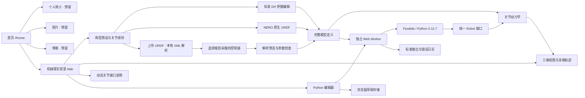

# YANN 个人网站与机械臂实验室

已实现可运行的网站：深色背景、橙色点缀、清晰留白，首页四个入口，机械臂实验室独立路由。个人简介、照片、博客保留入口并提示「正在准备」。信件页新增独立的留言和相册服务，配置与完整文件职责见 [信件留言与相册配置说明.md](信件留言与相册配置说明.md)。

## 页面与模块



| 文件 | 职责 |
| --- | --- |
| `index.html` | 首页、实验室、导航、接口参考和说明弹窗 |
| `assets/css/site.css` | 全站设计样式与桌面、平板、手机布局 |
| `assets/js/app.js` | 路由、界面状态、编辑器、日志和 Worker 生命周期 |
| `assets/js/scene.js` | Three.js 场景、机械臂建模、相机、网格、阴影和轨迹 |
| `assets/js/models.js` | DH 预设、模型校验、新增关节暂存与构型指纹 |
| `assets/js/geometry-editor.js` | DH 参数编辑、URDF 参数参考、分页与构型导出 |
| `assets/js/urdf-parser.js` | XML / 拓扑校验、分支链提取、固定变换、惯量和基本 visual 解析 |
| `assets/js/urdf-importer.js` | 文件选择/拖入、解析预览、末端选择及应用前检查 |
| `assets/js/kinematics.js` | 标准 DH 和原生 URDF 的齐次变换链 |
| `assets/js/physics.js` | 模型定义、重力、近似惯量、驱动、接触和状态快照 |
| `assets/models/nero/` | 源 URDF、从源文件生成的七轴模型 JSON |
| `scripts/import_nero.py` | 校验七轴链并提取 URDF 原始变换、限位、质量和惯性 |
| `assets/js/python-worker.js` | Python 运行时、`arm.Robot` 接口、仿真调度和输出限流 |
| `assets/vendor/` | 固定版本的本地 Three.js、Pyodide 运行资源与许可证 |
| `tests/physics.test.js` | 动力学行为和接口约束验证 |
| `tests/browser.mjs` | 实际浏览器与 Python 执行、交互、响应式布局验证 |
| `tests/kinematics.test.js` | DH 全参数、新增轴保留前缀、固定末端及独立 URDF FK 校验 |
| `tests/geometry-browser.mjs` | DH 参数填写、取消/应用、NERO 限位及 Python 位姿验证 |
| `tests/joint-types.test.js` | 直线关节驱动、连续多圈旋转、固定附件质量与视觉参数隔离 |
| `tests/urdf-browser.mjs` | 真实 XML 解析、上传/重试、分支、Python 混合关节与源文件下载 |
| `letter.html` | 隐藏信件/相册页，保留原有内容与照片引用；首页页脚信封按钮点击 10 次后进入 |

网站使用原生 ES Modules，无构建步骤。渲染与手动控制在主线程执行；Python 在 Worker 中执行，长时间计算可以通过「停止」终止，不会直接阻塞编辑器。Python 运行与手动控制共享同一个动力学实现及状态结构。

## 运行

在项目目录执行：

```bash
npm run dev
```

打开 `http://localhost:5173`，机械臂实验室位于 `/#lab`。`npm run dev` 同时启动信件 API；`npm run dev:static` 只提供静态网页，不能保存留言/上传照片。不能通过直接双击 HTML 启动 Python Worker。

渲染和 Python 资源都由本站提供，运行时不依赖第三方 CDN。Python 资源约 14 MB，首次启动需要加载；之后可由浏览器 HTTP 缓存复用。本版本内置 Python 标准库，不包含 NumPy 等额外包。

## 轴数与关节控制

「预设构型」和 1、3、6、7 轴快捷按钮加载完整构型；轴数输入和加减按钮用于修改当前模型。增加轴会打开构型参数弹窗，新 DH 参数为空，填写并应用后才会创建新的机械臂。删减轴也需要应用，已有前缀关节的几何参数不变。

DH 表包含 `a`、`alpha`、`d`、`theta_offset`、初始关节角、上下限、速度/力矩上限及质量。`a`、`d` 使用米，表内角度使用度，模型 JSON 和 Python 使用弧度。采用**标准 DH**，变换顺序为 `Rz(q + theta_offset) Tz(d) Tx(a) Rx(alpha)`。关节变量 `q` 与固定零位偏置 `theta_offset` 分开保存，不支持直接混用改进 DH。

「为待定义关节填入建议值」是显式操作：默认连杆长 0.15 m，其余 DH 参数为 0，仍需点击「应用构型」。参数未定义、上下限错误、初始角超出限位时无法应用。取消和 Esc 关闭会丢弃暂存修改，恢复原机械臂。

构型自动存储在浏览器，刷新与重置保留几何；可导出 JSON。最近一次自定义构型单独保留，切换预设后可通过「自定义构型」恢复。代码草稿以几何指纹分别存储，同轴数不同构型不会互相覆盖。

| 预设 | 定义 |
| --- | --- |
| 单轴转台 | 标准 DH，连杆长 0.32 m |
| 三轴平面臂 | 标准 DH，连杆长 0.48、0.36、0.22 m |
| 六轴空间臂 | 标准 DH，包含非零扭转角、偏距及空间腕部；教学用模型 |
| NERO 七轴 | 来自 `NERO20251209URDF.urdf` 的原生变换与限位 |

浏览器资源是有限的：目前为关节状态与桥接数据设置 32 MB 分配预算，按每轴 2,048 字节估算模型参数、矩阵与桥接状态，允许最多 16,384 轴。超过预算、非整数和非有限数值都会明确报错。三维建模最多显示前 128 个关节；所有已创建关节仍参与接口与动力学计算，关节滑块每页显示 6 个。超出三维显示规模时页面会提示。高轴数会降低运行速度。

三维视图采用 Y 轴向上。所有关节位置和方向由完整变换链计算，几何更改同时影响正运动学、渲染、重力矩和 Python Worker。Python 位姿与界面末端数值使用原生基座坐标；NERO 的原生 URDF 为 Z 轴向上，视图通过基座变换转为 Y 轴向上，并抬高 0.08 m 用于展示，此变换不包含在返回的原生位姿中。

### NERO 七轴来源与约定

源文件为 `/home/agx/works/urdf/NERO20251209URDF.urdf`，已复制到本站 `assets/models/nero/`。关节链按 `parent → child` 顺序解析，保留 7 个 revolute 关节及固定基座/末端变换，`origin.xyz`、`origin.rpy`、`axis`、限位、质量和惯性张量均取自源文件。模型 JSON 记录源文件 SHA-256。

URDF 原生关节变换使用 `T(xyz) Rz(yaw) Ry(pitch) Rx(roll) R(axis,q)`。不会将 URDF 的 `xyz/rpy` 直接填作 DH 参数；预设参数面板提供原始定义参考。URDF 已有的角度限位只读，初始关节角和仿真驱动上限可编辑。扩展 NERO 时，新增 DH 关节挂接在原始固定末端之后，前七轴定义保持原值。

文件七个关节的 `velocity` 和 `effort` 都为 0，不能作为可运行驱动上限；本站明确使用 **2 rad/s、30 N·m** 仿真替代值，参数面板注明不代表硬件。Link7 的源质量为 0，保留此值，积分器采用最小数值惯量稳定计算。

源目录未提供 URDF 中 `package://NERO20251209URDF/meshes/*.STL` 对应文件，因此七轴视图采用细长直线外壳、简洁圆柱关节、暖白/橙色/深灰配色和连接到第一关节的底座。外壳尺寸和材质仅位于渲染层；不改源 origin、axis、DH、限位、质量、惯性或 TCP。原生零位仍是一根直立的机械臂。外形不代表原厂网格。

### 上传自定义 URDF

机械臂配置区的「上传 URDF 构型」支持文件选择与拖入，文件最大 5 MB。XML 由浏览器 DOMParser 本地解析，不发送文件或网格请求。解析完成后选择根连杆到末端的控制链，再点击「检查构型参数」；检查面板点击「应用构型」后才替换当前机械臂。取消、无效文件和解析错误保留当前构型，支持重新选择同一个文件。进入导入或构型检查时取消尚未完成的预设请求，延迟响应不会覆盖正在检查的构型。

支持 fixed、revolute、continuous 和 prismatic。树模型可选择任意可用末端或中间连杆，控制数组仅包含所选链的活动关节；固定基座、中间连接与工具变换按原顺序保留。所选链包含 mimic、floating、planar 或未知类型时禁止导入，该分支在选择器中注明原因；仍可选择其他可用链。不支持直接展开 xacro，请先生成纯数值 URDF。

解析器验证 XML、唯一名称、parent/child 引用、单根树、连通性、数值、轴方向、限位与几何尺寸。禁止 DTD/外部实体。保留 source axis 原值，运算时归一化；origin 的 RPY 使用弧度，保持源精度。URDF 没有 DH 参数，不通过猜测转换为 DH。

| 关节类型 | Python 位置 / 速度 / 输出 | 页面显示 |
| --- | --- | --- |
| revolute / DH | rad / rad/s / N·m | ° |
| continuous | rad / rad/s / N·m，限位接口返回 ±Infinity | 累计角度，滑块为 ±180° 单圈窗口并选择邻近圈 |
| prismatic | m / m/s / N | mm，参数表明确使用 m |

continuous 不应用旋转硬限位。Python 多圈目标和初始值可超过 ±π。控制 Demo 根据选定构型生成直线关节索引，给不同类型的关节传入相应单位。

导入质量、COM、惯性张量、固定附件质量及 COM。未提供活动连杆惯性时使用 0.45 kg 和简化数值惯量；缺失或为零的 velocity/effort 使用旋转 2 rad/s 或直线 0.2 m/s，以及 30 N·m 或 30 N 的仿真替代值。所有替代和源零质量均在预览中说明。固定附件质量/质心聚合到其所属活动连杆，惯量为教学用对角近似，未完整求解复合刚体惯性。

解析 URDF visual 的 box、cylinder、sphere、origin 及内联/命名 RGBA 材质，并通过原始连杆坐标变换显示。仅上传 URDF 时，`package://`、相对路径或远程 mesh 对应文件未提供，使用同一风格的示意外壳并提示；不会自动访问这些路径。不支持纹理与碰撞网格加载。

上传源 XML 与来源文件名保存在模型中，可在原始参数参考中下载原文件；可用时记录 SHA-256。构型和代码在浏览器保存；文件较大导致存储配额不足时，页面提示导出构型 JSON。上传构型的显示底座可抬高，原生基座 FK 与 Python 位姿不包含该显示变换。

| Python 接口 | 行为与单位 |
| --- | --- |
| `Robot(dof=N)` | 连接当前模型，轴数不一致时抛出错误；也可用 `Robot()` 读取当前配置 |
| `robot.dof` | 当前模型的关节数 |
| `robot.time` | 当前累计仿真时间，秒 |
| `get_joint_positions()` | 返回 N 个实际关节位置，旋转 rad / 直线 m |
| `get_joint_velocities()` | 返回 N 个实际关节速度，旋转 rad/s / 直线 m/s |
| `get_joint_limits()` | 返回 N 个 `[lower, upper]`，rad / m；continuous 为 ±Infinity |
| `get_geometry()` | 返回完整构型字典，含 DH/URDF 参数、来源、限位与驱动上限 |
| `get_end_effector_pose()` | 返回原生基座坐标下的 4×4 末端齐次矩阵，平移单位为米 |
| `set_joint_positions(q)` | 设置 N 个位置目标，范围取自当前每轴限位，采用 PD 位置驱动与重力补偿 |
| `set_joint_velocities(dq)` | 设置 N 个速度目标，范围取自当前每轴速度上限，采用速度驱动与重力补偿 |
| `set_joint_torques(tau)` | 设置 N 个力矩 / 力，范围取自当前每轴力矩 / 力上限，保留重力与阻尼作用 |
| `await move_joints(q, duration=1.5)` | 三次平滑插值到目标位置，之后仿真 0.4 秒使控制器趋于稳定；duration 范围 `(0, 60]` 秒 |
| `await step(dt=1/120)` | 推进仿真并让出执行权，dt 范围 `(0, 0.1]` 秒 |

关节数组采用从 0 开始的索引，必须与配置轴数等长。旋转滑块的度转换为弧度，直线滑块的毫米转换为米；Python 始终使用原生 SI 单位。

```python
import math
from arm import Robot

robot = Robot()  # 使用页面所选轴数
target = robot.get_joint_positions()
limits = robot.get_joint_limits()
target[0] = max(limits[0][0], min(limits[0][1], math.radians(45)))
await robot.move_joints(target, duration=2.0)
print(robot.get_joint_positions())
```

自定义力矩控制算法示例：

```python
from arm import Robot

robot = Robot()
target = robot.get_joint_positions()
caps = [j["maxTorque"] for j in robot.get_geometry()["joints"]]
for _ in range(360):
    q = robot.get_joint_positions()
    dq = robot.get_joint_velocities()
    tau = [max(-cap, min(cap, 12*(r-x) - 3*v))
           for r, x, v, cap in zip(target, q, dq, caps)]
    robot.set_joint_torques(tau)
    await robot.step()
```

代码中的循环应定期执行 `await robot.step()`。运行期间连续 10 秒没有仿真帧或状态响应会被终止；输出限制为每秒 100 行，界面保留最近 250 条日志。停止按钮会销毁 Worker，下一次运行重新启动 Python。

## 物理模型与扩展位置

当前是教学用简化动力学：依据质量/质心与关节轴估算的对角关节惯量、重力力矩、粘性阻尼、位置/速度驱动、每轴限位、120 Hz 固定步长及半隐式积分。地面接触使用保守的穿透检测与步进回退，不包含完整关节惯性耦合、自碰撞、接触冲量求解或真实硬件标定。

如果后续需要更高精度，可以在保持 Python `Robot` 接口不变的情况下替换 `physics.js` 的动力学实现。需要服务端仿真时，Worker 的接口层可改为与后端交换命令和状态快照，页面配置、编辑器与三维渲染模块继续复用。

个人简介、照片和博客可分别增加页面模块，再接入现有路由；首页保留的四个卡片已经提供相应入口。

## 验证

```bash
npm test
```

动力学和运动学共 15 项检查，包含轴数/内存预算、位置收敛、速度和力矩响应、重力开关、限位、地面接触、快照恢复、完整 DH 变换、增删轴保留前缀和固定工具变换。NERO 的 31 组零位/随机姿态，与直接解析 XML 的独立 Python 正运动学参考进行完整 4×4 位姿比较（误差容限 1e-12）。

源 URDF 更新后运行：

```bash
python3 scripts/import_nero.py /path/to/source.urdf
python3 tests/generate_urdf_reference.py
npm test
```

导入脚本会同步本站的源 URDF 副本；重新生成定义和独立参考后，源文件与模型的 SHA-256 保持一致。

浏览器验证需要先运行本地 HTTP 服务、安装开发依赖并提供 Chrome 路径：

```bash
npm install
CHROME_PATH=/usr/bin/google-chrome npm run test:browser
CHROME_PATH=/usr/bin/google-chrome npm run test:geometry
CHROME_PATH=/usr/bin/google-chrome npm run test:urdf
```

可通过 `SITE_URL` 设置预览地址，`ARTIFACTS_DIR` 设置截图保存位置。已验证首页与四个入口、1/6 轴 Python Demo、三轴滑块、速度/力矩接口、错误代码反馈、129 轴分页、暂停/恢复/停止、无限循环终止、草稿恢复与下载，以及 390 px 手机和 768 px 平板布局。

构型浏览器检查还验证新增关节空白字段、未定义阻止应用、取消恢复、DH 参数进入 Python、NERO 原始限位和位姿、七轴 Demo、第八轴 DH 扩展及手机参数表滚动。

URDF 浏览器检查覆盖 11 类无效 XML/模型输入、分支与不支持的 mimic、非单位轴、固定变换和附件质量、基本 visual 与命名材质、上传 NERO 的 31 组 FK、mm 滑块、Python 直线和连续多圈控制、取消/重试、原始文件下载、存储恢复和手机弹窗。相机/外壳操作前后对照 NERO 关节定义，确认渲染不改源参数。
