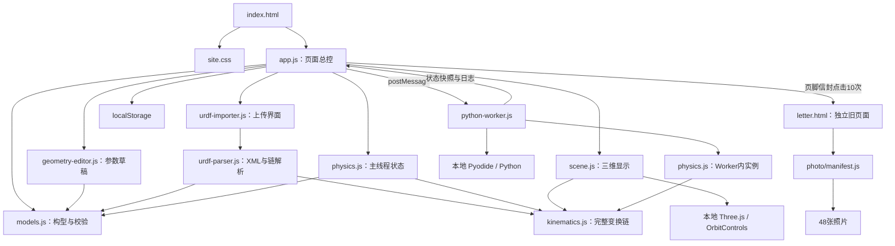
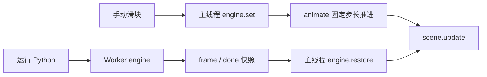
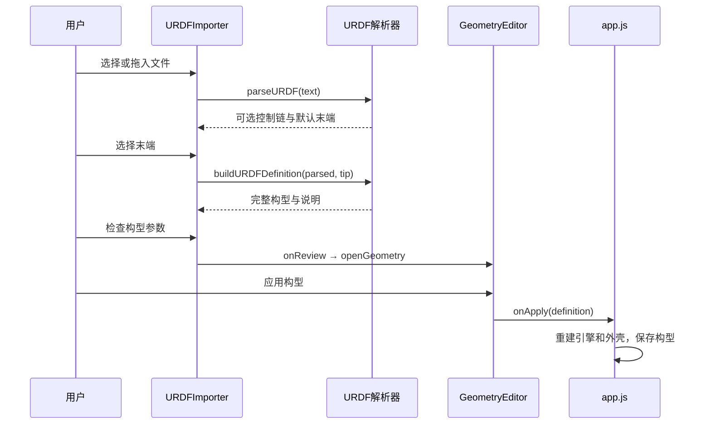

# yann 网站详细架构与代码说明

整理日期：2026 年 11 月 4 日。工作目录：`/home/agx/yann-site`。

本说明以当前工作区的实际文件和代码为准，包含独立标志预览页和页脚信封彩蛋入口。它描述已经实现的行为；规划中的扩展另行注明。文件清单包括页面、业务代码、模型、照片、第三方运行资源、测试、脚本和维护文档。

## 目录

1. [网站整体架构](#1-网站整体架构)
2. [目录组织与全部文件范围](#2-目录组织与全部文件范围)
3. [页面结构与样式](#3-页面结构与样式)
4. [主控模块 app.js](#4-主控模块-appjs)
5. [模型定义 models.js](#5-模型定义-modelsjs)
6. [构型编辑 geometry-editor.js](#6-构型编辑-geometry-editorjs)
7. [URDF 上传与解析](#7-urdf-上传与解析)
8. [运动学 kinematics.js](#8-运动学-kinematicsjs)
9. [动力学 physics.js](#9-动力学-physicsjs)
10. [三维显示 scene.js](#10-三维显示-scenejs)
11. [Python 执行与 Worker 通信](#11-python-执行与-worker-通信)
12. [数据结构、坐标与持久化](#12-数据结构坐标与持久化)
13. [旧版页面和相册](#13-旧版页面和相册)
14. [模型生成、测试与第三方资源](#14-模型生成测试与第三方资源)
15. [运行、发布与当前实现边界](#15-运行发布与当前实现边界)
16. [按需求定位修改位置](#16-按需求定位修改位置)
17. [完整文件清单](#17-完整文件清单)

## 1. 网站整体架构

当前是一个**浏览器端静态网站，加上独立的 Python Web Worker**。服务器只需提供静态文件；机械臂计算、Python 执行、代码编辑、URDF 解析都在访问者浏览器中完成。

| 层次 | 当前实现 | 作用 |
| --- | --- | --- |
| 页面 | 原生 HTML | 首页、实验室、参数和上传弹窗 |
| 样式 | 原生 CSS | 深色界面、橙色点缀、响应式布局 |
| 页面控制 | JavaScript ES Modules | 路由、交互、编辑器、状态和日志 |
| 三维显示 | 本地 Three.js 0.170.0 | WebGL 场景、机械臂外壳、相机和轨迹 |
| 运动学 | 项目自写 JavaScript | 标准 DH 与 URDF 原生变换链 |
| 动力学 | 项目自写 JavaScript | 120 Hz 步进、简化惯量、重力和关节驱动 |
| Python | 本地 Pyodide 0.27.7 / Python 3.12.7 | 执行用户写的控制算法 |
| 并发 | Web Worker | Python 与界面分别运行，支持终止计算 |
| 持久化 | localStorage | 保存构型和按构型区分的代码草稿 |
| 文件交互 | File / Blob / DOMParser | 本地导入 URDF、导出源文件、JSON 与 Python |
| 开发验证 | Node.js、Python、Playwright | 单元检查、独立 FK 对照、真实浏览器验证 |

项目没有 React、Vue、Vite、后端业务服务或数据库，也没有网站用户登录系统。`package.json` 用于启动本地静态服务和测试，不承担页面打包。

### 1.1 页面入口与独立页面

| 访问入口 | 实现 | 当前状态 |
| --- | --- | --- |
| `/`、`/#home` | `index.html` + `app.js` | 新版个人首页 |
| `/#lab` | 同一个 `index.html`，切换可见区域 | 机械臂实验室 |
| `/letter.html` | 独立 HTML，内联 CSS 和 JS | 保留的旧版信件/相册页面 |
| `/design/logo-concepts.html` | 独立 HTML，内联 SVG、CSS 和 JS | 四组标志设计预览，尚未接入主站 |
| 首页个人简介、照片、博客按钮 | `data-placeholder` 事件 | 预留入口，点击显示准备中提示 |

`#lab` 是浏览器 URL 的 hash，不需要服务器配合重写路由。除了 hash 精确等于 `#lab` 的情况，`route()` 都显示首页。

旧版 `letter.html` 可直接访问，也可通过首页页脚右下角的灰色信封按钮触发：当前页面累计点击 10 次后，同一标签页跳转到 `letter.html`。按钮不显示计数或解锁提示，不持久化点击次数；新版“照片”按钮仍为预留入口。

### 1.2 模块依赖关系

箭头表示调用、导入或数据传递。



两个线程使用的是同一个 `ArmPhysics` 实现，运行时各自有一个实例。它们通过消息交换快照，**没有共享同一块状态内存**。

### 1.3 三种数据要分开理解

| 数据 | 例子 | 谁负责 |
| --- | --- | --- |
| 构型定义 | 轴数、DH、origin、axis、限位、质量、工具变换 | `models.js`、URDF 解析器 |
| 当前仿真状态 | 实际位置 q、速度 dq、目标、模式、时间 | `physics.js` |
| 外观 | 外壳粗细、配色、相机、阴影、轨迹 | `scene.js` |

因此，改变 `scene.js` 的颜色和外壳尺寸，不会修改 DH 或 URDF 关节定义；改变构型参数则会影响运动学和动力学。

## 2. 目录组织与全部文件范围

```text
yann-site/
├── index.html                       新版主站入口
├── letter.html                      独立旧版信件/相册
├── package.json                     开发和测试命令
├── gen_photos.js                     照片清单生成工具
├── ARCHITECTURE.md                   原有架构与使用说明
├── 网站详细架构与代码说明.md          本文
├── DEPLOY.md                        部署指南
├── GIT.md                           Git 指令说明
├── 发布与更新流程.md                  发布操作说明
├── .gitignore                       Git 忽略规则
├── .githooks/
│   └── pre-commit                   照片清单同步钩子
├── design/
│   └── logo-concepts.html           独立标志设计方案预览
├── assets/
│   ├── favicon.svg                  网站图标
│   ├── css/site.css                 全站样式
│   ├── js/                          9 个业务模块
│   │   ├── app.js
│   │   ├── models.js
│   │   ├── geometry-editor.js
│   │   ├── urdf-importer.js
│   │   ├── urdf-parser.js
│   │   ├── kinematics.js
│   │   ├── physics.js
│   │   ├── scene.js
│   │   └── python-worker.js
│   ├── models/nero/
│   │   ├── NERO20251209URDF.urdf
│   │   └── definition.json
│   └── vendor/                      10 个第三方资源/说明文件
│       ├── three.module.js
│       ├── OrbitControls.js
│       ├── THREE-LICENSE.txt
│       ├── README.md
│       └── pyodide/
│           ├── pyodide.mjs
│           ├── pyodide.asm.js
│           ├── pyodide.asm.wasm
│           ├── python_stdlib.zip
│           ├── pyodide-lock.json
│           └── LICENSE
├── photo/
│   ├── manifest.js                  旧版相册的文件名数组
│   └── 48 个 .jpg                   末章逐一列出
├── scripts/
│   └── import_nero.py               NERO 预设生成器
└── tests/
    ├── physics.test.js
    ├── kinematics.test.js
    ├── joint-types.test.js
    ├── browser.mjs
    ├── geometry-browser.mjs
    ├── urdf-browser.mjs
    ├── generate_urdf_reference.py
    └── fixtures/
        ├── nero-fk.json
        └── custom-branches.urdf
```

最终核对时共 94 个项目文件，含本文、独立标志预览页和 48 张 JPG。除本文外的文件总大小约 **121.53 MiB**，其中照片目录约 106.73 MiB，本地第三方目录约 14.51 MiB。文件存放在项目中不意味着访问首页就会全部下载：照片只在旧相册使用，Python 资源首次运行代码才按需加载。

清单不展开 `.git/` 的对象、日志和索引，它们是 Git 内部元数据。`node_modules/`、Python 缓存及测试报告属于忽略的开发产物，也不作为网站源文件逐一说明。

## 3. 页面结构与样式

### 3.1 [index.html](index.html)

这是新版网站唯一的 HTML 入口。它包含完整页面骨架，末尾以 `type="module"` 加载 `assets/js/app.js`。

| 区域 / DOM ID | 内容 | 控制来源 |
| --- | --- | --- |
| 页面 head | 编码、viewport、描述、主题色、favicon、CSS | HTML 静态声明 |
| SVG symbol 库 | 箭头、机械臂、代码、播放等图标 | `<use href="#i-...">` 复用 |
| header / `data-nav` | 导航与当前页面标记 | `route()` |
| `home-page` | 标题、首页机械臂、四个入口 | `route()`、首页事件 |
| `hero-scene` | 首页 Three.js canvas 容器 | 独立 `heroScene` |
| `lab-page` | 实验室整体 | `route()` |
| 配置面板 | 预设、上传、轴数、参数编辑、关节控制 | `selectPreset()` 等 |
| `joint-controls` | 运行时生成的关节滑块 | `buildJoints()` |
| `lab-scene` | 实验室 canvas、网格控制、视图提示 | `RobotScene` |
| telemetry | 时间、原生基座末端位置、控制模式 | `updateTelemetry()` |
| 接口面板 | Python API 说明，动态轴数 | `updateConfig()` |
| `code-input` | 实际输入 Python 的 textarea | 编辑器事件 |
| `code-highlight` / `highlighted-code` | 与 textarea 重叠的高亮层 | `highlight()` |
| `line-numbers` | 行号 | `refreshEditor()` |
| `console-output` | stdout、stderr 和状态日志 | `log()` |
| `info-dialog` | 仿真模型、性能与运行说明 | 原生 dialog |
| `geometry-dialog` | DH / URDF 参数检查与编辑 | `GeometryEditor` |
| `urdf-dialog` | 文件选择、解析预览、控制链选择 | `URDFImporter` |
| `toast` | 临时提示 | `toast()` |
| `letter-envelope` | 首页页脚的灰色信封，累计点击 10 次进入隐藏信件页 | `letterClicks` 点击事件 |

页面不是多个模板拼接。所有面板和弹窗在同一个 HTML 中，JavaScript 根据运行状态更新 DOM。

### 3.2 [assets/css/site.css](assets/css/site.css)

样式通过 CSS 变量统一颜色和字体。

| 变量 | 当前值 | 用途 |
| --- | --- | --- |
| `--bg` | `#101114` | 页面背景 |
| `--panel` | `#17181c` | 面板底色 |
| `--line` | `#2b2c31` | 边框与分隔线 |
| `--text` | `#f0f0f2` | 主文字 |
| `--muted` | `#898990` | 次要文字 |
| `--orange` | `#fa8b50` | 主要操作与强调色 |
| `--green` | `#a1ba9d` | 状态提示 |
| `--mono` / `--sans` | 系统字体候选列表 | 代码与正文 |

主要样式组：页头和首页卡片；实验室 Grid；配置和关节 range；三维视口与 telemetry；API 面板；叠层代码编辑器；控制台；通用按钮和 dialog；DH 横向表格；URDF 拖入区；手机适配。

布局断点包括 1550、1250、1000、700 px。宽屏采用配置/仿真/API 三列，编辑器和输出位于下方；中等宽度改为两列；手机改为纵向排列，仿真视口在前。参数表保留自身横向滚动，弹窗底部操作区固定可见。

`prefers-reduced-motion` 同时影响 CSS 动效和首页自动演示。CSS 当前采用大量紧凑长行，物理行数较少，并不意味着样式逻辑很少。

### 3.3 [assets/favicon.svg](assets/favicon.svg)

这是浏览器标签页和主站页头共同使用的小型矢量图标：暖橙色圆底，深色线条构成小写 y。`index.html` 在 head 用 `<link rel="icon">` 引用它，在页头用 `` 引用同一文件，并配合小写 `yann` 文字。它与主页面内的 SVG symbol 功能图标库分开。

### 3.4 [design/logo-concepts.html](design/logo-concepts.html)

这是独立的标志设计对比页面，可直接通过 `/design/logo-concepts.html` 访问。所有 SVG、CSS 和 JavaScript 都内联在该文件中，不导入主站业务模块；当前首页也没有引用该预览页或其图形。

| 代码区域 | 作用 |
| --- | --- |
| 内联 CSS 变量和 `.card` / `.grid` | 定义深色、浅色和单色预览，双列方案卡片及手机单列布局 |
| 隐藏 SVG `<defs>` | 以 `joint-y`、`inline-y`、`inline-word`、`milled-y`、`orbit-y` 定义关节、夹爪、字标和轨迹图形 |
| `logo-1` 至 `logo-4` symbol | 组合四组完整标志，通过 `<use>` 在不同尺寸复用 |
| 四个 article 卡片 | 展示完整字标、页头尺寸、16 px 标签页图标和设计说明 |
| `[data-mode]` 点击监听 | 切换 body 的 `light` / `mono` 类，并更新按钮 `aria-pressed` 状态 |

页面不保存选择，不请求模型或 Python 资源，也不自动替换 `assets/favicon.svg`。需要正式采用某组标志时，还要将对应 SVG 接入主站页头与 favicon。

## 4. 主控模块 app.js

文件：[assets/js/app.js](assets/js/app.js)。这是页面的总协调者，负责把构型、仿真、三维画面、代码编辑和 Worker 连起来。

### 4.1 初始化顺序

1. 定义安全读写 localStorage 的包装。
2. `savedModel()` 尝试恢复完整构型；失败则创建六轴空间臂。
3. 创建实验室 `engine`，再创建独立六轴 `heroEngine`。
4. 创建参数编辑器、URDF 上传器，注册按钮、键盘和消息事件。
5. 根据构型指纹恢复代码；没有草稿则生成 Demo。
6. 更新配置、滑块和 range 样式，执行 `route()`。
7. 启动 `requestAnimationFrame(animate)`。

Three.js 场景延迟到首次进入对应页面才创建；Pyodide 延迟到首次运行 Python 才加载。

### 4.2 页面状态

| 状态 | 意义 |
| --- | --- |
| `engine` | 实验室当前仿真实例 |
| `heroEngine` | 首页演示实例，与实验室构型独立 |
| `heroScene` / `labScene` | 两个页面各自的 Three.js 场景 |
| `isLab` | 当前是否显示实验室 |
| `geometryEditing` | 参数编辑或导入流程是否打开 |
| `loadingModel` | 是否正在获取预设构型 |
| `presetRequest` | 异步预设请求序号，用于忽略过期响应 |
| `manualActive` | 主线程是否需要推进手动控制 |
| `running` | Python 程序是否正在执行 |
| `paused` | 仿真是否暂停 |
| `worker` / `runtimeReady` | Worker 引用和 Python 就绪状态 |
| `jointPage` | 当前滑块分页，每页 6 轴 |
| `speed` | 仿真速度倍率，界面范围 0.25–2 |
| `accumulator` | 主线程固定步长累积时间 |
| `heartbeat` / `watchdog` | 程序响应检测 |
| `saveTimer` / `toastTimer` | 草稿保存和提示消失计时器 |

### 4.3 函数职责

| 函数 / 小工具 | 作用 |
| --- | --- |
| `$` | 按 ID 获取 DOM |
| `storage.get()` / `storage.set()` | 捕获浏览器存储异常；读失败返回 null，写失败返回 false |
| `savedModel()` | 读取并校验保存构型，失败回到六轴预设 |
| `draftKey()` | 按构型指纹生成代码草稿键 |
| `demo(model)` | 按轴数和直线关节索引生成平滑运动 Python 示例 |
| `toast()` | 显示约 4.2 秒的提示 |
| `setupScene()` | 创建三维场景；WebGL 初始化失败显示降级提示 |
| `route()` | 切换首页/实验室、标题、导航和首次场景创建 |
| `rangePaint()` | 更新滑块已完成部分的 CSS 百分比 |
| `displayScale()` / `displayUnit()` | rad 转 °，m 转 mm |
| `sliderValue()` | continuous 折算到单圈窗口，其他关节直接换算 |
| `buildJoints()` | 生成当前页滑块，并把输入换成原生单位传入引擎 |
| `updateConfig()` | 刷新轴数、来源、类型、API 数量、分页与遥测 |
| `applyDefinition()` | 校验并应用完整构型，重建仿真/外壳、保存、加载匹配草稿 |
| `openGeometry()` | 取消过期预设请求，停止运行程序，打开参数草稿 |
| `selectAxes()` | 轴数校验后生成增删轴草稿，交给参数面板 |
| `selectPreset()` | 创建内置 DH 构型，或 fetch NERO JSON，或恢复最近自定义构型 |
| `resetArm()` | 保留构型，重建引擎回到 q0，清除运动状态 |
| `setSimStatus()` | 更新视口中的状态文字 |
| `updateTelemetry()` | 显示时间、原生末端坐标和实际关节位置 |
| `escapeHTML()` | 转义代码中的特殊字符，供高亮层使用 |
| `highlight()` | 用正则区分 Python 注释、字符串、关键词、数字和调用名称 |
| `refreshEditor()` | 重建高亮和行号，同步滚动与光标状态 |
| `syncScroll()` | textarea、高亮层、行号同步滚动 |
| `cursorPosition()` | 计算当前行号和列号 |
| `loadCode()` | 设置编辑器内容并立即保存到当前构型草稿 |
| `saveCode()` | 保存 Python，更新保存状态指示 |
| `log()` | 创建带时间戳的日志；单条最多 6000 字符，保留最近 250 条 |
| `updateRunningUI()` | 运行/编辑/加载期间禁用运行按钮，运行期间禁用滑块 |
| `updatePauseButton()` | 同步暂停图标、按钮标题和 aria 状态 |
| `finishCode()` | 结束运行状态、关闭 watchdog，使主线程继续承接仿真 |
| `stopCode()` | terminate Worker，关节停止并保持当前位置 |
| `runCode()` | 启动或复用 Worker，发送模型/状态/代码，处理响应和超时 |
| `sendSettings()` | 向 Worker 更新重力和速度倍率 |
| `animate()` | 首页演示或实验室渲染循环，必要时推进主线程动力学 |

### 4.4 事件与操作

文件末尾把页面按钮连接到以上函数：导航；预留卡片；1/3/6/7 轴预设；轴数加减；参数编辑；关节分页；重置；重力和轨迹开关；速度倍率；网格；相机复位；全屏；暂停；说明弹窗；加载 Demo；代码复制/下载；清空输出。

`letter-envelope` 是首页页脚的隐藏入口。`letterClicks` 在页面内累计，达到 10 次时先清零，再用 `window.location.assign('letter.html')` 跳转。相对路径指向本站信件页；刷新后重新计数，从信件页返回后也可再次触发。图标为 HTML 内的 `i-envelope` symbol，外观由 `.footer-signoff` / `.letter-envelope` 控制。

编辑器是 **textarea + pre 高亮层**，不是 Monaco 或 CodeMirror。支持 Ctrl/⌘+Enter 运行、Tab 插入 4 个空格、Enter 根据当前行缩进并在冒号后加一级。它没有 Python 语法诊断、自动补全或调试断点。

代码输入后等待 450 ms 自动保存。复制使用 Clipboard API，失败时尝试选中文字并执行浏览器复制；下载生成 `controller_Ndof.py`。

`pagehide` 保存草稿并终止 Worker；切换站内首页/实验室 hash 本身不等于离开整个文档。

### 4.5 仿真控制权



Python 执行时主线程不重复积分，避免同一个运动被推进两次。Python 完成后，当前目标/模式保留，主线程可继续推进。用户按停止时则切到位置保持并清零速度。

## 5. 模型定义 models.js

文件：[assets/js/models.js](assets/js/models.js)。它定义“什么样的构型可以运行”，不负责显示页面。

| 导出 / 内部函数 | 作用 |
| --- | --- |
| `MEMORY_BUDGET` | 32 MiB 的估算关节数据预算 |
| `BYTES_PER_JOINT` | 每轴估算 2048 字节 |
| `PRESETS` | 单轴、三轴、六轴、NERO 七轴元数据；HTML 选项另外静态声明 |
| `validateDOF(n)` | 正安全整数校验，预算上限为 16,384 轴 |
| `dhJoint(index, params)` | 创建带控制上限/质量的标准 DH 关节对象 |
| `createPreset(id)` | 创建 1/3/6 轴 DH 预设；NERO 必须由 app 加载 JSON |
| `createGeneric(n)` | 为数字形式的引擎构造通用模型；与界面新增轴流程不同 |
| `resizeDefinition(definition,n)` | 深拷贝构型并生成增删轴草稿 |
| `finite()` / `vector()` / `pose()` / `attachment()` | 检查数值、向量、位姿和附件矩阵 |
| `validateDefinition()` | 检查关节完整性、限位、质量、上限、附加体和 visual |
| `modelFingerprint()` | 对物理定义做 32 位 FNV 风格散列，生成草稿标识 |

### 5.1 内置 DH 默认值

`dhJoint()` 默认 `a=0.15 m`，`alpha=d=offset=q0=0`；限位 ±π；最大速度 6 rad/s；最大力矩 100 N·m；质量 0.45 kg。

1/3/6 轴预设会覆盖连杆几何与初始姿态；它们是教学用构型。NERO 来源于独立模型文件。

### 5.2 新增轴为什么不会自动运动

界面的增加轴调用 `resizeDefinition()`，新关节的 `a / alpha / d / offset` 都设为 `null`，`configured=false`。已有前缀关节保持原值。必须填写完整或者显式使用“建议值”，再应用构型。

如果原构型存在固定 `tool`，第一次追加的关节把该变换作为 `prefix`，保证新轴接在原末端之后。减少轴时切掉尾部活动关节，清理越界的 `extraBodies` 和 `renderVisuals`，并清空尾部工具变换。

### 5.3 指纹和校验边界

指纹包括 `base`、完整 `joints`、`tool` 以及非空 `extraBodies`；不包括 `renderVisuals`、模型名称、说明文字或源 XML。因此视觉变化不会产生新的控制草稿。由于整份 joint 对象参与散列，质量/上限/初始值等变化也会改变草稿键。

这个短指纹用于区分草稿，不是文件完整性校验。源 URDF 的 SHA-256 是另一件事。

模型校验检查有限数值和必要范围，但不是完整的物理有效性证明：例如附件矩阵检查形状与最后一行，并未证明旋转块正交；惯性张量也未完整验证正定性。

## 6. 构型编辑 geometry-editor.js

文件：[assets/js/geometry-editor.js](assets/js/geometry-editor.js)。导出 `GeometryEditor`。

| 方法 / 数据 | 作用 |
| --- | --- |
| `fields` / `DEG` | 参数列名和表格单位换算 |
| `constructor()` | 绑定应用、取消、分页、建议值和导出按钮 |
| `open(definition)` | 深拷贝为 draft，定位待定义轴，生成说明，打开 dialog |
| `validate()` | 校验 draft；重新判断 DH 几何是否完整 |
| `renderRows()` | 每页 6 轴；DH 可编辑，URDF 用原生参数摘要替代 DH 四列 |
| `renderURDF()` | 显示原始 joint 名称、类型、parent/child、xyz、rpy、axis、mass |
| `onApply` / `onCancel` | 把确认或取消交还 `app.js` |

表格内 DH 扭转角、偏置和旋转位置使用度，写回模型时转成弧度。直线关节位置使用米，速度 m/s，力 N。混合构型逐个字段标单位。

URDF 的 `origin / axis` 不是 DH，不能在 DH 列里编辑。原始上下限和质量只读；可以修改初始状态与仿真驱动上限。continuous 限位显示“无限”，内部仍保留单圈界面窗口数值。

“建议值”只填缺失值，已有数值不覆盖。导出 JSON 前必须通过完整校验，生成 `<id>_<N>dof.json`。

原始 URDF 下载：NERO 预设下载项目静态文件；上传构型把 `uploadedURDF` 转成 Blob 下载。更换参考构型时释放旧的 Blob URL。

## 7. URDF 上传与解析

### 7.1 [assets/js/urdf-importer.js](assets/js/urdf-importer.js)

这是上传界面控制器，导出 `URDFImporter`；它负责交互，不实现矩阵计算。

| 方法 | 作用 |
| --- | --- |
| `constructor()` | 注册选择文件、拖入、链选择、检查和关闭事件 |
| `open()` | 进入导入流程，通知 app 暂停构型操作 |
| `error(message)` | 清空待应用定义，禁用检查按钮，显示错误 |
| `load(file)` | 大小检查、读取文本、XML 解析、建立控制链选项 |
| `build()` | 根据当前末端构造模型，展示轴类型和解析说明 |

`request` 序号避免旧文件读取或旧 SHA-256 结果覆盖较新的选择；关闭 dialog 也会令未完成任务失效。重置 file input 的 value 允许连续选择同一文件重试。

默认选择最长的受支持末端链。不支持的链仍显示，附原因并禁用；也可选有活动关节的中间连杆作为末端。

### 7.2 [assets/js/urdf-parser.js](assets/js/urdf-parser.js)

这个模块把 XML 文本变成统一的构型定义。使用浏览器 `DOMParser`，没有后端上传接口。

| 函数 | 作用 |
| --- | --- |
| `URDF_FILE_LIMIT` | 5 × 1024 × 1024 字节，界面称 5 MB |
| `children()` / `child()` | 按 localName 读取直接子节点 |
| `number()` | 读取有限数字；缺值可用显式 fallback |
| `vector()` | 解析空格分隔向量并检查维数 |
| `pose()` | 读取 origin 的 xyz 与 rpy，缺值默认为零 |
| `named()` | 要求 link/joint 有 name |
| `parseURDF()` | XML、拓扑校验；生成链候选和路径查询 |
| `inertial()` | 读取质量、COM、惯性坐标旋转和六个惯量元素 |
| `visuals()` | 提取 box/cylinder/sphere、visual origin 和 RGBA |
| `buildURDFDefinition()` | 把选定链转换成 joints/prefix/tool/visual/附件，生成来源与说明 |
| 内部 `addLink()` | 保存当前连杆 visual，必要时保存固定附件质量 |

`parseURDF()` 返回 `links / joints / incoming / outgoing / paths / candidates / rootLink / defaultTip` 等中间结构。Map 中保留 XML 节点，仅供当前解析过程使用，最终保存的定义是可序列化对象。

### 7.3 校验与支持范围

| 情况 | 当前处理 |
| --- | --- |
| malformed XML / 非 robot 根节点 | 报错 |
| DTD / ENTITY | 显式拒绝 |
| 重名 link/joint、缺失 parent/child 引用 | 报错 |
| 多根、多个父关节、循环、不连通 | 报错 |
| 连杆数大于 32,768 | 拒绝 |
| fixed | 保留固定变换，不占控制轴 |
| revolute | 支持，有硬位置限位 |
| continuous | 支持，没有硬位置限位 |
| prismatic | 支持，沿 axis 直线移动 |
| mimic / floating / planar / 未知关节 | 所在链不可导入，其他可用链仍可选择 |
| axis 缺失 | 使用 URDF 默认方向 `[1,0,0]` |
| axis 为零 | 拒绝；非单位方向在计算时归一化，源数值不覆盖 |
| 未展开 xacro 的非数字参数 | 拒绝，要求先生成纯数值 URDF |
| mesh、纹理 | 不加载外部文件；mesh 提示后使用示意外壳 |
| collision / transmission / gazebo 等 | 当前没有相应物理/驱动实现 |

整个 URDF 的拓扑都会校验；详细运动参数主要校验所选控制链，并非完整 URDF schema 验证器。

### 7.4 固定连接怎么保留

固定连接出现在活动关节之前：写入该活动关节的 `prefix`。

固定连接出现在最后一个活动关节之后：写入模型的 `tool`。

固定附件的 visual 和质量：用 `anchor` 指向所属活动关节，用 `attachment` 表示从该活动关节运动后的连杆坐标系到附件的固定矩阵。

基座 visual 使用 `anchor=-1`。活动轴之前的固定基座质量不参与活动链动力学；活动轴之后、有源 inertial 的固定附件才加入 `extraBodies`。

### 7.5 缺失值的仿真替代

| 数据 | 替代规则 |
| --- | --- |
| 活动连杆没有 inertial | mass=0.45 kg，COM 为零，采用简化惯量 |
| 有质量但没有 tensor | 保留质量，使用简化数值惯量 |
| 源质量为 0 | 保留 0，动力学采用最小有效惯量 |
| 旋转 velocity 缺失或为 0 | 2 rad/s |
| 直线 velocity 缺失或为 0 | 0.2 m/s |
| effort 缺失或为 0 | 旋转 30 N·m，直线 30 N |
| 零位不在源限位中 | q0 采用离 0 最近的合法位置，并显示说明 |

源 `sourceVelocity / sourceEffort` 与仿真 `maxVelocity / maxTorque` 分别保存。解析说明不会把替代值说成硬件规格。

### 7.6 上传到应用的完整路径



解析完成不等于应用完成。取消任何检查阶段都不替换原构型。

## 8. 运动学 kinematics.js

文件：[assets/js/kinematics.js](assets/js/kinematics.js)。它是纯计算模块，不读取 DOM、不保存草稿、不决定外观。

### 8.1 矩阵约定

内部矩阵是长度 16 的 **行主序 4×4 数组**。平移为下标 `3 / 7 / 11`，最后一行为 `[0,0,0,1]`。

| 函数 | 作用 |
| --- | --- |
| `identity()` | 单位矩阵 |
| `multiply(a,b)` | 4×4 矩阵相乘 |
| `rotation(axis,q)` | 归一化任意轴的旋转矩阵 |
| `jointTransform(joint,q)` | 旋转关节旋转，直线关节平移 |
| `poseTransform({xyz,rpy})` | URDF origin 的完整位姿矩阵 |
| `standardDH(joint,q)` | 标准 DH 闭式矩阵 |
| `position(frame)` | 提取平移 |
| `transformPoint(frame,p)` | 点变换，包含平移 |
| `transformDirection(frame,p)` | 方向变换，不包含平移 |
| `forwardChain(definition,q)` | 计算整条链的坐标系、关节原点、方向和末端 |

### 8.2 变换顺序

标准 DH：

```text
Rz(q + offset) · Tz(d) · Tx(a) · Rx(alpha)
```

URDF 旋转关节：

```text
T(xyz) · Rz(yaw) · Ry(pitch) · Rx(roll) · R(axis, q)
```

URDF 直线关节：

```text
T(xyz) · Rz(yaw) · Ry(pitch) · Rx(roll) · T(normalize(axis) × q)
```

每轴之前先乘其 `prefix`。完成所有活动轴后再乘 `tool`。`base` 是整条链进入显示世界的初始变换。

### 8.3 forwardChain 返回值

| 字段 | 含义 |
| --- | --- |
| `origins` | 每个活动轴运动前的关节原点 |
| `axes` | 在显示世界中的单位轴方向 |
| `preFrames` | 每轴应用 q / DH 之前的坐标系 |
| `frames` | 每轴运动变换之后的连杆坐标系 |
| `centers` | 世界质心；URDF 按 COM 变换，DH 使用几何中点近似 |
| `tip` | 完整工具变换后的世界末端位置 |
| `tipFrame` | 完整工具变换后的 4×4 世界位姿 |

没有逆运动学求解器、雅可比接口或轨迹规划器。`move_joints()` 属于关节空间插值，不是笛卡尔路径规划。

## 9. 动力学 physics.js

文件：[assets/js/physics.js](assets/js/physics.js)。导出 `ArmPhysics`，以及 `DT=1/120`、`RENDER_LIMIT=128`，并转导出轴数和预算检查。

### 9.1 内部状态

| 数据 | 内容 |
| --- | --- |
| `definition` / `n` | 已验证的构型深拷贝和轴数 |
| `q` / `dq` | Float64Array，实际关节位置/速度 |
| `target` | 位置模式目标 |
| `velocity` | 速度模式目标 |
| `torque` | 力矩/力模式输入 |
| `inertia` | 每轴近似有效惯量；直线轴为有效质量 |
| `points` / `axes` / `centers` | 世界关节原点、末端、方向和质心 |
| `lengths` | 当前相邻关节/末端距离 |
| `masses` | 含固定附件的聚合质量 |
| `gravityTorque` | 各轴重力力矩，直线轴存重力投影力 |
| `chain` | 当前 `forwardChain()` 结果 |
| `mode` | position / velocity / torque |
| `gravity` / `time` / `contacts` | 重力开关、仿真时间、接触回退计数 |

### 9.2 方法

| 方法 / 小工具 | 作用 |
| --- | --- |
| `clamp(x,a,b)` | 将驱动力、积分速度或位置限制在给定区间内 |
| `constructor(model)` | 构型校验、状态分配、q0 初始化、初始 FK 和惯量估算 |
| `estimateInertia()` | 倒序累积质量矩，估算绕轴惯量；直线轴采用下游质量 |
| `validate(values,mode)` | 数组长度、有限数值、位置/速度/力矩范围检查 |
| `set(values,mode)` | 设置整条臂统一控制模式及对应输入数组 |
| `forward()` | 更新 FK、固定附件聚合 COM、重力投影 |
| `getNativeTip()` | 去掉显示基座变换，返回原生坐标末端位置 |
| `getNativePose()` | 返回原生基座坐标的嵌套 4×4 位姿 |
| `step(dt)` | 细分步长、积分、限位和地面回退 |
| `snapshot()` | 将状态数组转换为普通数组，供线程消息传递 |
| `restore(state)` | 恢复快照并更新 FK |

### 9.3 驱动与步进

`step()` 允许 `dt` 在 `(0,0.1]` 秒内，自动拆成不大于 `1/120 s` 的子步。

位置模式命令：`I × (95 × 位置误差 − 19 × dq) − 重力项`。

速度模式命令：`I × 18 × 速度误差 − 重力项`。

力矩模式：直接使用用户输入。三种模式都会受驱动上限约束，积分还包含重力与 `0.04 × dq` 阻尼。先更新速度，再更新位置，属于半隐式积分。

非 continuous 关节触碰硬限位时截到边界并清零速度。continuous 不做位置硬截断。

任一关节原点或末端低于世界 y=0.025 m 时，回退整个子步的 q、清零速度并增加 `contacts`。这个检测使用骨架点，**不使用渲染外壳或 URDF collision 的体积**。

### 9.4 近似程度

重力依据质量、COM 和轴方向逐步更新。惯量在构造引擎时估算一次，当前并不随每个姿态重新求完整质量矩阵。固定附件聚合质量和 COM，未完整计算复合刚体惯性。

各关节采用对角有效惯量，没有完整惯性耦合、科氏/离心项、自碰撞或接触冲量求解。源码是自写的教学级动力学，不是 MuJoCo、Bullet、PhysX 或 Gazebo 的浏览器封装。

## 10. 三维显示 scene.js

文件：[assets/js/scene.js](assets/js/scene.js)。导出 `RobotScene`，把仿真数据绘制成 WebGL 画面。

### 10.1 场景组成

PerspectiveCamera；OrbitControls；半球光、主方向光、轮廓光和暖色点光；接收阴影的地面；GridHelper；robot Group；关节组；连杆 segment 组；源 visual 网格；末端示意件；轨迹 Line。

renderer 开启抗锯齿、PCFSoft 阴影、ACES 色调映射；设备像素比最多 2。相机可旋转、缩放、平移；ResizeObserver 跟随容器更新尺寸。

### 10.2 方法

| 方法 / 工具 | 作用 |
| --- | --- |
| `Y` / `point()` | 显示向上向量和矩阵平移提取 |
| `constructor()` | 创建场景、相机、灯光、地面、基础材质、观察器和轨迹缓冲 |
| `mesh()` | 创建网格、缩放、定位，统一开启阴影 |
| `createSegment()` | 创建细长盒状外壳和深灰色带，放在独立 Group 中 |
| `placeSegment()` | 根据两个 FK 端点定位、定向并拉伸连杆；太短则隐藏 |
| `buildRobot()` | 按当前构型重建底座、关节、连杆、源 visual 和末端 |
| `resetCamera()` | 根据 FK 和可见网格包围盒调整相机/阴影/网格比例 |
| `resize()` | 更新 renderer 尺寸和相机比例 |
| `clearTrail()` | 清空轨迹点和绘制范围 |
| `update(record)` | 应用当前 FK、更新源 visual、记录轨迹并渲染 |

### 10.3 当前恢复后的外观

| 材质 | 色值 | 用途 |
| --- | --- | --- |
| orange | `0xe67834` | 底座、部分关节/连杆、末端示意件 |
| white | `0xe5e6e4` | 暖白连杆与关节 |
| dark | `0x24262c` | 底板、色带、关节内圈 |
| metal | `0x8f9299` | 小型轴心与固定点 |

URDF 示意连杆的 `slim=0.025`，DH 为 `0.045`；外壳横向尺寸按此缩放。关节使用简洁圆柱，颜色按 `i % 3 === 1` 橙色、其他暖白交替。已去掉膨大的球形关节壳、圆润长壳和大量装饰环。

外观改回细长风格，仍保留后来建立的外壳逻辑：底座连接到第一轴；关节盖方向跟随真实轴；连杆长度根据 FK 端点更新；活动轴、固定工具与源 visual 继续使用原坐标关系。

### 10.4 显示和物理的边界

标准 DH 连杆显示为沿 d 再沿 a 的两段。URDF 连杆主要连接当前关节原点与下一关节原点/末端；直线轴分别显示滑移段和后续段。

源 `renderVisuals` 存在时，按所属 anchor 隐藏相应示意关节/连杆，显示原始基本几何。最终 visual 矩阵为：

```text
(base 或 chain.frames[anchor]) · attachment · poseTransform(visual.origin)
```

URDF cylinder 以局部 Z 为轴，Three.js cylinder 默认以 Y 为轴，创建几何时做相应旋转。

源 visual 的尺寸、颜色和 origin 不因全站配色而强制改写。换构型时释放这批专用几何和材质，复用通用几何与材质。

3D 只显示前 128 轴，当前接口和动力学仍处理全部已分配轴。轴数大于 16 时隐藏部分装饰。轨迹缓冲最多 500 点，新点与上次点的距离达到阈值才记录，满后移除最早点。

`scene.js` 不求解关节控制，也不修改模型定义。显示外壳只是示意表面，不是物理碰撞体或实际 NERO STL。

## 11. Python 执行与 Worker 通信

文件：[assets/js/python-worker.js](assets/js/python-worker.js)。它位于 Web Worker 上下文，不能直接操作页面 DOM。

### 11.1 Python 是在哪里运行的

`loadPyodide()` 加载本站 `assets/vendor/pyodide/` 中的资源，在 Worker 的 WebAssembly 运行时执行 Python。没有调用操作系统 Python 进程，也没有把算法发送到服务器。

页面的 Python 代码只存在于编辑器/localStorage，并在运行时通过 `postMessage` 发送给该浏览器 Worker。文件选择也只把本地 XML 交给浏览器解析。

### 11.2 Worker 内部代码

| 函数 / 对象 | 作用 |
| --- | --- |
| `delay(ms)` | 异步让出执行权，实现暂停等待和时间节奏 |
| `asArray()` | 将 PyProxy / 可迭代对象转换为 JavaScript 数组 |
| `output()` | stdout/stderr 转消息，限制每秒 100 行、单条 6000 字符 |
| `checkpoint(dt)` | 等待解除暂停、推进物理、发布快照、按 speed 调整节奏 |
| `self.onmessage` | 处理 run、settings、pause |
| `armGet` / `armSet` / `armValidate` | Python 与 JS 状态/校验桥接 |
| `armStep` / `armTime` / `armDOF` | Python 获取轴数、时间与推进接口 |
| `armLimits` | continuous 返回 ±Infinity，其他返回源限位 |
| `armGeometry` / `armPose` | 完整模型 JSON 和原生位姿 |
| 内嵌 `Robot` Python 类 | 对外关节控制 API |
| `arm_module` | 动态写入 `sys.modules['arm']`，使 `from arm import Robot` 可用 |

**项目没有磁盘上的 `arm.py`**；这个 Python 模块每次运行由 Worker 引导代码创建。

用户程序在独立 `globals` 中执行，结束时销毁对应 PyProxy。Worker 未停止时可复用已加载的 Pyodide；按停止或离开页面会销毁 Worker，下次重新启动运行时。

### 11.3 消息协议

| 方向 | type | 数据 / 行为 |
| --- | --- | --- |
| app → Worker | `run` | dof、definition、state、gravity、speed、code |
| app → Worker | `settings` | gravity、speed，重设墙钟与仿真时间基准 |
| app → Worker | `pause` | paused，暂停/恢复时补偿墙钟时间 |
| Worker → app | `loading` | Python 启动提示 |
| Worker → app | `ready` | 当前 Python 版本 |
| Worker → app | `stdout` | 正常输出文本 |
| Worker → app | `stderr` | 错误/输出限流文本 |
| Worker → app | `frame` | 当前仿真快照 |
| Worker → app | `done` | 最终快照，程序完成 |
| Worker → app | `error` | 异常字符串及可用的当前快照 |

`frame` 约每隔 30 ms 以上发布一次，而不是每个 120 Hz 子步都发送。快照走普通消息复制，没有 SharedArrayBuffer。

### 11.4 Python API

| API | 行为 |
| --- | --- |
| `Robot()` | 连接当前页面构型 |
| `Robot(dof=N)` | N 必须是当前相同整数；bool 和不匹配轴数拒绝 |
| `robot.dof` | 当前活动轴数 |
| `robot.time` | 当前仿真时间，秒 |
| `get_joint_positions()` | 返回实际 q 的 Python list |
| `get_joint_velocities()` | 返回实际 dq 的 Python list |
| `get_joint_limits()` | 每轴 [lower, upper]；continuous 为无限 |
| `get_geometry()` | 返回完整 definition 字典 |
| `get_end_effector_pose()` | 原生基座坐标中的嵌套 4×4 矩阵 |
| `set_joint_positions(q)` | 设置位置模式和完整目标数组 |
| `set_joint_velocities(dq)` | 设置速度模式和完整目标数组 |
| `set_joint_torques(tau)` | 设置力矩/力模式和完整输入数组 |
| `await step(dt=1/120)` | 推进物理并让出 Worker 执行权 |
| `await move_joints(q,duration=1.5)` | 三次平滑关节插值，之后再稳定 48 步，即 0.4 秒 |

所有关节共用当前 `mode`，目前不能在同一时刻给不同关节分别选择位置/速度/力矩模式。数组长度必须等于轴数，索引从 0 开始。

`move_joints()` 的插值权重是 `u²(3−2u)`，duration 范围 `(0,60] s`。两次 duration=2 的 Demo 名义仿真时长为 `2+0.4+2+0.4=4.8 s`。

### 11.5 暂停和响应检查

用户循环需要 `await robot.step()` 等异步节点让出执行权；同步无限循环不能处理后续 Worker 消息，但主线程仍可 `terminate()`。

主线程每 500 ms 检查一次：运行时已就绪且 10 秒无有效状态响应会终止；Python 首次加载最多等待 120 秒；暂停时跳过这项检查。stdout/stderr 不单独刷新心跳，避免打印无限循环维持运行。

Web Worker 提供计算隔离和终止能力，不等于专门的多租户安全沙箱。目前没有额外禁用 Python 的 JS 桥接或网络能力。

## 12. 数据结构、坐标与持久化

### 12.1 完整构型 definition

| 字段 | 用途 |
| --- | --- |
| `schemaVersion` | 模型结构版本，当前 1 |
| `id` / `label` / `source` | 预设标识、名称、DH/URDF 来源 |
| `base` | 显示基座 xyz/rpy |
| `joints` | 有序活动关节数组，长度就是 dof |
| `tool` | 最后活动轴之后的固定变换列表 |
| `notes` | 来源和仿真替代说明 |
| `sourceFile` / `sourceSHA256` | 源文件名和可用时的完整性摘要 |
| `baseNote` | NERO JSON 的显示坐标约定说明 |
| `rootLink` / `tipLink` | 上传构型选择的原生根/末端 |
| `uploadedURDF` | 上传源 XML 文本，用于保存和源文件下载 |
| `extraBodies` | 固定附件的质量、COM 与锚定矩阵 |
| `renderVisuals` | 基本 visual 的锚定、局部位姿、尺寸和颜色 |

并不是每个来源都会有全部字段。NERO 预设 JSON 没有上传源全文和解析得到的 basic visual，源 URDF 是单独静态文件。

### 12.2 关节对象

公共字段：`kind / name / configured / q0 / lower / upper / maxVelocity / maxTorque / mass / prefix`。

| 来源 | 特有字段 |
| --- | --- |
| DH | `a / alpha / d / offset` |
| URDF | `parent / child / origin / axis / com / inertialRPY / inertia` |
| 上传 URDF | `motion` 为 revolute 或 prismatic；`continuous` 为布尔；`sourceVelocity / sourceEffort` |

NERO 预设早期对象未写 `motion`；计算代码把不存在 motion 的 URDF 轴当作旋转，保持兼容。

`maxTorque` 在直线关节上也沿用这个字段名，但它表示力 N。Python 的 `set_joint_torques()` 同样沿用统一接口名。

### 12.3 固定附件和 visual

```javascript
// 结构示意，不是一个完整可运行构型
extraBodies: [{
  anchor: 0,
  attachment: [/* 行主序 4×4 固定矩阵 */],
  mass: 1,
  com: [0, 0, 0.1],
  inertialRPY: [0, 0, 0],
  inertia: {/* 六个张量元素，可选 */}
}]

renderVisuals: [{
  anchor: 0, // -1 表示基座
  attachment: [/* 行主序 4×4 固定矩阵 */],
  origin: {xyz: [0, 0, 0], rpy: [0, 0, 0]},
  type: 'box',
  size: [0.1, 0.05, 0.2],
  color: [0.8, 0.8, 0.8, 1]
}]
```

### 12.4 运行快照

`snapshot()` 包含 `q / dq / target / velocity / torque / mode / time / contacts`。重力和速度倍率属于运行设置，通过消息另外发送；快照不包含完整构型和网格。

### 12.5 单位与坐标

| 类型 / 场景 | 位置 | 速度 | 输出 |
| --- | --- | --- | --- |
| 旋转关节 Python / engine | rad | rad/s | N·m |
| 直线关节 Python / engine | m | m/s | N |
| 旋转滑块/初始表格 | ° | 表格仍 rad/s | 表格 N·m |
| 直线滑块 | mm | — | — |
| 直线参数表 | m | m/s | N |
| URDF origin xyz / rpy | m / rad | — | — |
| 末端位置 | 原生基座 X/Y/Z，m | — | — |

显示世界为 Y 向上，URDF 原生一般按此项目采用 Z 向上。NERO 的显示 `base.rpy=[−π/2,0,0]`，显示高度 0.08 m。上传时还会根据初始骨架最低点抬高显示基座。

`getNativePose()` 计算 `inverse(base) × tipFrame`，排除展示旋转和平移。Python 位姿和实验室 telemetry 一致。首页 Hero 的数字直接显示演示实例世界坐标，不能混同实验室原生坐标。

### 12.6 localStorage

| 键 | 内容 | 写入时机 |
| --- | --- | --- |
| `yann.lab.geometry.v1` | 当前完整定义 JSON | 应用构型 |
| `yann.lab.custom-geometry.v1` | 最近自定义定义 JSON | 应用 custom 构型 |
| `yann.lab.controller.v2.<fingerprint>` | Python 字符串 | 加载、输入防抖、运行/离开前 |
| `missTanxiaoCount_v1` | 旧页面点击计数 | 旧版 `bump()` |

这些数据只在当前浏览器、当前 origin 可用，没有跨设备同步。刷新恢复的是定义/q0和代码，不是上次运行时间和完整运动快照。

大 URDF 可能使构型 JSON 超过 localStorage 配额，且 current/custom 会分别保存副本。保存失败时模型本次仍可运行，页面提示导出 JSON。当前提供 JSON 导出，**没有 JSON 文件导入入口**；自定义构型菜单恢复的是浏览器保存的对象。

## 13. 旧版页面和相册

### 13.1 [letter.html](letter.html)

这是之前保留的独立互动页面，CSS 和 JS 都在 HTML 里，使用普通 script 的 IIFE。它不导入机械臂模块，也不受新版样式影响。

页面包含信封开场、按时间切换的问候和夜间主题、打字机文字、点击爱心计数、进度条、句子、语音、粒子和彩蛋、照片查看、复制和摇一摇。

| 函数 / 事件 | 作用 |
| --- | --- |
| `$` | 旧页面 DOM 查询 |
| `pickQuote()` | 随机选一句内置文案 |
| `nextQuote()` | 按数组顺序轮换文案 |
| `setQuote()` | 更新句子，长文字自动缩小字号 |
| `bump()` | 增加计数、存储、更新进度，触发里程碑彩蛋 |
| `typeWriter()` | 定时逐字显示主文字 |
| `buzz()` | 浏览器支持时振动 |
| `say()` | 使用 SpeechSynthesis 朗读，失败显示提示 |
| `spawnParticle()` / `spawnPlus()` | 点击处短暂粒子和 +1 效果 |
| `toast()` | 旧页面独立提示 |
| `showEgg()` | 展示临时彩蛋层 |
| `celebrate()` / `comboEgg()` / `heartRain()` | 满百/16 次等交互反馈 |
| envelope click | 信封打开后进入主界面 |
| heart pointerdown / 长按 | 计数与长按反馈 |
| `showPhotoAt()` | 归一化照片索引、更新 img.src 与数量 |
| `closePhoto()` | 关闭照片层 |
| 相册 prev/next | 循环切换图片，首次随机起点 |
| share click | 将内置分享文字复制到剪贴板 |
| `onMotion()` | 读取设备加速度，阈值判断并防抖计数 |
| `startShake()` | 注册 devicemotion 监听 |
| shake click | 在需要的浏览器申请传感器权限 |
| gesturestart | 阻止该页面的手势缩放行为 |

语音使用浏览器提供的语音服务，具体是否需要网络由浏览器和语音决定，网站没有独立 TTS 后端。振动和摇一摇取决于设备/权限。

文件末尾保留了一个 NUL 字节，普通 `rg` 会把它判为二进制；检索该页面源码时可以用 `rg -a`。本次文档整理未修改旧页面内容。

### 13.2 [photo/manifest.js](photo/manifest.js)

内容为 `window.PHOTO_LIST = [...]`，列出按文件名排序的 48 张照片。旧页面加载它，然后复制数组用于相册导航。不存在服务器“列出照片目录”接口。

图片 src 使用 `photo/` 加 `encodeURIComponent(name)`，避免中文文件名直接拼接的问题。每次显示只更新当前 img，源码没有批量预加载整套照片。

### 13.3 [gen_photos.js](gen_photos.js)

设计职责：扫描 `photo/`，筛选 jpg/jpeg/png/gif/webp/heic/avif 扩展名、排序并写入 `photo/manifest.js`。扩展名入选不等于所有浏览器都能解码该格式。

当前存在模块制式问题：`package.json` 设 `type: module`，这个 `.js` 却使用 CommonJS 的 `require()` 和 `__dirname`。标准 Node 直接执行 `node gen_photos.js` 会与模块模式冲突。现有 manifest 已在仓库中，所以旧页面读取它不依赖每次访问时运行生成器。

### 13.4 [.githooks/pre-commit](.githooks/pre-commit)

设计职责：提交前检查 node 是否存在，执行 `node gen_photos.js`，随后 `git add photo/manifest.js`，把清单同步进提交。

本机已配置 `core.hooksPath=.githooks`，本地钩子权限为 775；但 Git 索引中的权限是 100644，换机器检出后执行权限可能不保留。再加上生成器模块模式问题，不能把“提交时自动同步照片”当成已经可靠的维护流程。

钩子没有 `set -e`，生成器失败后仍会走 `git add`，因此也不保证以生成错误阻止提交。这里记录现状，没有在文档任务中修改脚本。

## 14. 模型生成、测试与第三方资源

### 14.1 NERO 模型文件

| 文件 | 作用 |
| --- | --- |
| [NERO20251209URDF.urdf](assets/models/nero/NERO20251209URDF.urdf) | 原始模型副本，含固定连接、七个 revolute、限位、惯性与 mesh 路径 |
| [definition.json](assets/models/nero/definition.json) | 可直接给 ArmPhysics 使用的 NERO 预设定义 |

原始来源路径为 `/home/agx/works/urdf/NERO20251209URDF.urdf`；访问者浏览器使用网站副本，不会读取开发机绝对路径。

源 SHA-256 为 `ca2f819da642e6b992330cfe35491eecefee2ec157e38a0842c88f21cf7affca`。预设保留原始 origin、axis、限位和惯性。七轴源 velocity/effort 均为 0，仿真使用明确替代；Link7 源质量为 0。

只复制了 URDF 和定义 JSON，没有提供对应 STL 文件。所谓 NERO 外壳是示意渲染。预设加载请求 JSON；源 URDF 用于下载、生成和测试；用户上传时才走浏览器 XML 解析器。

### 14.2 [scripts/import_nero.py](scripts/import_nero.py)

离线生成工具，使用 Python 标准库 ElementTree、hashlib、json。

| 函数 / 过程 | 作用 |
| --- | --- |
| `ROOT` / `SOURCE` | 项目根与可选命令行源文件 |
| `vector()` | 字符串向量转 float 列表 |
| `pose()` | XML origin 转 xyz/rpy |
| `main()` | 从 world 顺着 parent 链提取七轴，保存固定 prefix/tool、原始数据和 SHA-256，写出 JSON |

它专门面向 NERO 的串联七轴 revolute，按 parent 建字典，不是任意分支 URDF 的通用导入器。任意上传使用的是 `urdf-parser.js`。

重新生成会覆盖 `definition.json` 和必要的源副本；脚本内仍有早期“骨架”说明文字，可能覆盖当前 JSON 中更新过的展示说明，修改生成内容时要同步维护。

### 14.3 [tests/generate_urdf_reference.py](tests/generate_urdf_reference.py)

这是独立 FK 基准生成器，直接从 XML 读取并使用另一套 Python 矩阵公式，**不导入网站运动学代码**。

`matmul()` 做嵌套矩阵乘法；`origin_matrix()` 计算完整 RPY；`fk()` 按固定/旋转链累乘。本工具针对 NERO 的 `[0,0,1]` 轴做断言。随机种子为 20251209，生成零位加 30 组限位内随机姿态，共 31 组，写入 `tests/fixtures/nero-fk.json`。

### 14.4 测试文件

| 文件 | 重点 | 运行环境 |
| --- | --- | --- |
| [physics.test.js](tests/physics.test.js) | 5 项：轴数/预算、位置收敛、速度/力矩/限位、重力、地面回退与快照 | Node |
| [kinematics.test.js](tests/kinematics.test.js) | 7 项：标准 DH 全参数、增删轴、源数据、31 组 4×4 FK、固定末端与 URDF+DH | Node |
| [joint-types.test.js](tests/joint-types.test.js) | 3 项：直线单位/驱动、continuous 多圈、固定附件及视觉指纹隔离 | Node |
| [browser.mjs](tests/browser.mjs) | 首页、Demo、滑块、129 轴、暂停/终止、无限循环、草稿/下载、手机平板布局 | Playwright + Chrome + HTTP |
| [geometry-browser.mjs](tests/geometry-browser.mjs) | 空白新增 DH、校验/取消/应用、Python 参数与位姿、NERO、扩展第八轴 | 同上 |
| [urdf-browser.mjs](tests/urdf-browser.mjs) | 真 DOMParser、11 类无效输入、分支/mimic、上传/下载、直线/多圈 Python、NERO FK、响应取消与移动端 | 同上 |
| [nero-fk.json](tests/fixtures/nero-fk.json) | 源摘要、31 组 q 与完整原生 frame；作为外部基准 | 静态测试数据 |
| [custom-branches.urdf](tests/fixtures/custom-branches.urdf) | 固定连接、非单位轴、直线轴、continuous、另一分支、mimic 和基本 visual | 测试输入 |

`npm test` 共 15 个 Node 测试项；31 个 FK 样本属于其中的一项对照，并非 31 个独立测试名称。

浏览器脚本使用 `CHROME_PATH / PLAYWRIGHT_MODULE / SITE_URL / ARTIFACTS_DIR` 环境变量。默认 Chrome 为 `/usr/bin/google-chrome`，网站为 `http://127.0.0.1:5173`，截图写到 `/tmp/yann-...-checks`。URDF 的无远程资源断言当前硬编码 localhost:5173，改 SITE_URL 时需一并调整这项测试条件。

当前三套浏览器测试聚焦新版主站，没有覆盖旧版 `letter.html` 及照片生成钩子。

### 14.5 本地第三方资源

| 文件 | 作用 / 建议维护方式 |
| --- | --- |
| [three.module.js](assets/vendor/three.module.js) | Three.js 的完整 ES Module；几何、材质、灯光、WebGLRenderer 等；按上游版本维护，不逐函数改写 |
| [OrbitControls.js](assets/vendor/OrbitControls.js) | 相机轨道交互；three 导入改为本地相对路径 |
| [THREE-LICENSE.txt](assets/vendor/THREE-LICENSE.txt) | Three.js MIT 许可 |
| [README.md](assets/vendor/README.md) | 固定依赖版本、来源及目录说明 |
| [pyodide.mjs](assets/vendor/pyodide/pyodide.mjs) | Pyodide JavaScript 加载入口与 Python/JS 高层 API |
| [pyodide.asm.js](assets/vendor/pyodide/pyodide.asm.js) | Emscripten 生成的 JS glue，连接 WASM、虚拟文件系统和运行时 |
| [pyodide.asm.wasm](assets/vendor/pyodide/pyodide.asm.wasm) | 编译后的 Python/WebAssembly 核心，约 9.64 MiB |
| [python_stdlib.zip](assets/vendor/pyodide/python_stdlib.zip) | Python 标准库归档，约 2.25 MiB |
| [pyodide-lock.json](assets/vendor/pyodide/pyodide-lock.json) | 运行时包索引/版本元数据，存在索引不代表所有第三方包已安装 |
| [LICENSE](assets/vendor/pyodide/LICENSE) | Pyodide 与相关组件的许可声明 |

vendor 是发布运行资源，不是项目自行维护的算法代码。当前未预装 NumPy 等第三方 Python 包。应用内置运行流程从同一网站获取资源，没有 CDN import。

## 15. 运行、发布与当前实现边界

### 15.1 本地运行

```bash
cd /home/agx/yann-site
npm run dev
```

等价于 Python 静态 HTTP 服务监听 5173。访问 `http://localhost:5173/` 或 `http://localhost:5173/#lab`。这个 Python 服务不是仿真后端；不启动网站上的 Python 控制算法。

不能只双击 HTML 并以 file:// 运行完整平台，ES Module、Worker 和 WASM 加载需要正常 HTTP 环境。

### 15.2 检查命令

```bash
npm test

# 以下命令需要先有本地 HTTP 服务和可用 Chrome/Playwright
CHROME_PATH=/usr/bin/google-chrome npm run test:browser
CHROME_PATH=/usr/bin/google-chrome npm run test:geometry
CHROME_PATH=/usr/bin/google-chrome npm run test:urdf
```

`npm install` 安装的是浏览器测试依赖，不是网站运行所必需的三维/Python资源；这些已在 vendor 中。当前仓库未含 `package-lock.json`。

文档初次整理时仅校验了文件、函数名和清单，没有重跑上述仿真测试。页脚信封入口后来通过临时浏览器脚本验证了点击次数、刷新/返回行为、信件页加载和桌面/手机布局；该脚本位于 `/tmp`，不属于仓库测试套件。

### 15.3 发布相关文件

| 文件 | 内容 | 如何理解 |
| --- | --- | --- |
| [DEPLOY.md](DEPLOY.md) | GitHub + Vercel + 域名的早期完整教程 | 有旧 Windows 路径、旧仓库示例和历史 DNS 数值 |
| [GIT.md](GIT.md) | Git 初始化、远程、提交、分支、回退指令 | 日常参考，操作前以当前仓库状态为准 |
| [发布与更新流程.md](发布与更新流程.md) | 当前目录示例、Git 推送和照片同步说明 | 部分描述还停留在旧版单 HTML + 相册时期 |
| [ARCHITECTURE.md](ARCHITECTURE.md) | 较短的主站架构和使用说明 | 重点在机械臂平台；本文补齐完整文件和代码职责 |
| [.gitignore](.gitignore) | 忽略 node_modules、macOS 文件、测试报告、Python 缓存 | 不影响浏览器路由 |

仓库没有 `vercel.json`、后端 functions、容器配置、CI workflow 或 Service Worker。可用静态文件服务器托管整个网站；真实线上项目、域名和部署状态需要另行检查托管平台，不能单凭文档确定。

现有部署教程的 DNS、平台界面和自动部署时长是历史操作描述，本文未验证这些外部配置。也没有本次执行 git commit、push 或部署。

### 15.4 当前能力与边界

| 已有能力 | 当前边界 |
| --- | --- |
| 任意正整数轴数输入 | 估算预算最多 16,384，3D 最多 128；不是实际无限内存 |
| 多分支 URDF 上传 | 最终只控制选择的一条串联链 |
| 旋转/直线/连续轴 | 不支持 mimic、floating、planar |
| origin/axis/固定连接原值保留 | 没有自动 DH 转换或 xacro 展开 |
| basic visual | 没有 STL/DAE/纹理包上传、碰撞网格和实际 NERO mesh |
| 教学动力学 | 无完整耦合、自碰撞或真实硬件标定 |
| 关节空间平滑运动 | 没有 IK、笛卡尔轨迹规划或路径避障 |
| 本地 Python | 无服务端 Python、ROS 通信或硬件命令 |
| 浏览器草稿/构型保存 | 无账号、数据库、云同步或模型版本库 |
| JSON/Python/源 URDF 导出 | 尚无 JSON 导入入口 |
| 首页四个入口 | 简介、照片、博客仍为占位；旧相册另有 URL |

另外，URDF 解析提示中还有“圆润示意模型”，NERO 生成脚本还有“骨架”字样。这是未同步的旧说明文案，当前真实外观以 `scene.js` 的细长外壳为准；本次只记录，不修改业务代码。

## 16. 按需求定位修改位置

| 你想改什么 | 主要文件 | 需要一起留意 |
| --- | --- | --- |
| 首页文案/按钮/布局 | `index.html`、`site.css` | 新功能的事件和路由在 `app.js` |
| 标志方案预览/正式接入 | `design/logo-concepts.html`、`index.html`、`assets/favicon.svg` | 预览页目前独立，图形尚未接入主站 |
| 真正实现个人简介/博客/新版照片 | 页面骨架、CSS、`app.js` | 当前仅有占位事件，数据来源也需定义 |
| 外壳审美、配色、粗细 | `scene.js` | 保持 FK/anchor 和模型定义独立 |
| 新增内置 DH 预设 | `models.js` | 同步 HTML select、快捷按钮和测试 |
| 改 NERO 原始参数 | 源 URDF、`import_nero.py` | 重新生成 JSON/独立 FK fixture 并校验 |
| 改新增轴默认/待定义规则 | `resizeDefinition()`、GeometryEditor | 区分 API 通用创建与界面增加轴 |
| 支持新 URDF 类型 | `urdf-parser.js` | models、kinematics、physics、UI 单位、Python 都要支持 |
| 支持真实 STL/DAE 外形 | 上传流程、parser、scene | 资源包/路径解析和独立网格加载机制尚未存在 |
| 增加机器人算法接口 | `python-worker.js` | 相应 JS 求解、接口说明和浏览器执行验证 |
| 提高动力学精度 | `physics.js` | 保留快照/控制协议，明确新物理参数 |
| 改 Python 编辑体验 | `app.js`、HTML、CSS | 当前是 textarea，替换编辑器需保留草稿/快捷键 |
| 后端仿真/硬件连接 | 新服务与 Worker/通信层 | 当前没有任何后端/ROS 接口可直接启用 |
| 增删旧相册照片 | `photo/`、manifest 生成器、Git hook | 先解决 CommonJS/ESM 和钩子执行权限问题 |
| 更新第三方版本 | `assets/vendor/` | 同步许可、README，并验证 WASM/Python/Three.js 兼容 |

推荐阅读顺序：`index.html` → `app.js` → `models.js` → `kinematics.js` → `physics.js` → `scene.js` → `python-worker.js`，之后再看参数编辑与 URDF 上传解析。旧版相册可单独阅读 `letter.html`。

## 17. 完整文件清单

以下清单由当前目录扫描生成：所有业务文件和每张图片逐一列出。大小是扫描时的实际文件大小；行数是物理行，紧凑/生成文件不宜用行数衡量复杂度。本文自身在清单中作为新生成文档单列。

### 17.1 页面、代码、资源、脚本与文档（46 个）

| 文件 | 大小 | 物理行数 | 职责 |
| --- | --- | --- | --- |
| [.githooks/pre-commit](.githooks/pre-commit) | 363 B | 8 | 提交前调用照片清单生成器，并暂存 manifest；当前生成器有模块模式冲突。 |
| [.gitignore](.gitignore) | 76 B | 6 | 忽略依赖、系统缓存、测试报告和 Python 缓存。 |
| [ARCHITECTURE.md](ARCHITECTURE.md) | 15.61 KiB | 215 | 原有主站架构、仿真与使用说明。 |
| [DEPLOY.md](DEPLOY.md) | 7.81 KiB | 206 | 早期 GitHub/Vercel/自有域名上线教程，含历史路径和配置示例。 |
| [GIT.md](GIT.md) | 4.17 KiB | 192 | Git 常用操作参考。 |
| [assets/css/site.css](assets/css/site.css) | 38.30 KiB | 33 | 首页、实验室、参数/导入弹窗、编辑器、日志与响应式样式。 |
| [assets/favicon.svg](assets/favicon.svg) | 206 B | 4 | 新版页面标签的矢量图标。 |
| [assets/js/app.js](assets/js/app.js) | 25.37 KiB | 372 | 页面总控：路由、状态、构型应用、控制、编辑器、Worker、存储与日志。 |
| [assets/js/geometry-editor.js](assets/js/geometry-editor.js) | 8.97 KiB | 128 | 参数草稿分页、单位换算、应用/取消、JSON 与源 URDF 下载。 |
| [assets/js/kinematics.js](assets/js/kinematics.js) | 2.86 KiB | 66 | 行主序 4×4、标准 DH、原生 URDF 和完整 FK 链。 |
| [assets/js/models.js](assets/js/models.js) | 6.92 KiB | 115 | DH 预设、轴数预算、增删轴草稿、定义校验与构型指纹。 |
| [assets/js/physics.js](assets/js/physics.js) | 7.73 KiB | 134 | ArmPhysics：状态、惯量、重力、三种驱动、步进、地面回退、快照。 |
| [assets/js/python-worker.js](assets/js/python-worker.js) | 4.97 KiB | 115 | Pyodide 加载、动态 arm.Robot、仿真桥接、暂停/节奏和消息输出。 |
| [assets/js/scene.js](assets/js/scene.js) | 13.02 KiB | 225 | Three.js 场景、细长示意外壳、源 basic visual、相机、网格、轨迹。 |
| [assets/js/urdf-importer.js](assets/js/urdf-importer.js) | 4.27 KiB | 82 | 文件选择/拖入、解析预览、控制链选择、异步结果取消和检查流程。 |
| [assets/js/urdf-parser.js](assets/js/urdf-parser.js) | 11.44 KiB | 148 | XML 拓扑/参数解析、控制链提取、固定变换、附件、visual 和来源信息。 |
| [assets/models/nero/NERO20251209URDF.urdf](assets/models/nero/NERO20251209URDF.urdf) | 9.30 KiB | 243 | NERO 原始 URDF 副本；包含七个活动轴与固定基座/工具、源 mesh 路径。 |
| [assets/models/nero/definition.json](assets/models/nero/definition.json) | 7.51 KiB | 415 | NERO 可执行预设 JSON；原始运动学/惯量与明确的仿真驱动替代值。 |
| [assets/vendor/OrbitControls.js](assets/vendor/OrbitControls.js) | 31.39 KiB | 1523 | 相机拖动旋转、缩放、平移；导入路径已指向本地 Three.js。 |
| [assets/vendor/README.md](assets/vendor/README.md) | 586 B | 6 | 第三方固定版本、来源与目录用途。 |
| [assets/vendor/THREE-LICENSE.txt](assets/vendor/THREE-LICENSE.txt) | 1.06 KiB | 21 | Three.js 的 MIT 许可。 |
| [assets/vendor/pyodide/LICENSE](assets/vendor/pyodide/LICENSE) | 16.33 KiB | 373 | Pyodide 与关联组件许可。 |
| [assets/vendor/pyodide/pyodide-lock.json](assets/vendor/pyodide/pyodide-lock.json) | 109.58 KiB | 1 | Python 运行时包索引与版本元数据，不是 npm lock。 |
| [assets/vendor/pyodide/pyodide.asm.js](assets/vendor/pyodide/pyodide.asm.js) | 1.20 MiB | 17 | Emscripten 生成的 JavaScript 运行时桥接代码。 |
| [assets/vendor/pyodide/pyodide.asm.wasm](assets/vendor/pyodide/pyodide.asm.wasm) | 9.64 MiB | 二进制 | 编译后的 WebAssembly/Python 核心。 |
| [assets/vendor/pyodide/pyodide.mjs](assets/vendor/pyodide/pyodide.mjs) | 13.60 KiB | 4 | loadPyodide 启动入口与 JS/Python API。 |
| [assets/vendor/pyodide/python_stdlib.zip](assets/vendor/pyodide/python_stdlib.zip) | 2.25 MiB | 二进制 | Python 标准库归档。 |
| [assets/vendor/three.module.js](assets/vendor/three.module.js) | 1.25 MiB | 54571 | 本地 Three.js 0.170.0：WebGL 渲染器和通用三维类。 |
| [design/logo-concepts.html](design/logo-concepts.html) | 11.91 KiB | 62 | 独立标志设计对比页；内联四组 SVG、尺寸预览和深/浅/单色切换。 |
| [gen_photos.js](gen_photos.js) | 664 B | 16 | 扫描 photo 图片，生成 window.PHOTO_LIST；仍是 CommonJS 写法。 |
| [index.html](index.html) | 23.47 KiB | 96 | 新版首页/实验室 DOM、SVG 图标、API 参考和三种弹窗。 |
| [letter.html](letter.html) | 23.15 KiB | 548 | 独立旧版信件/相册；CSS、JS、交互和彩蛋都内联。 |
| [package.json](package.json) | 497 B | 16 | ES Module 模式与 dev/test 命令；声明 Playwright 开发依赖。 |
| [photo/manifest.js](photo/manifest.js) | 1.90 KiB | 1 | 旧版相册全局 PHOTO_LIST，列出全部 48 张 JPG。 |
| [scripts/import_nero.py](scripts/import_nero.py) | 3.85 KiB | 83 | 离线提取 NERO 七轴并生成 definition.json，保留源文件并记录 SHA-256。 |
| [tests/browser.mjs](tests/browser.mjs) | 6.81 KiB | 99 | 首页/控制/Python/暂停停止/大轴数/保存下载/响应式的浏览器检查。 |
| [tests/fixtures/custom-branches.urdf](tests/fixtures/custom-branches.urdf) | 1.91 KiB | 19 | 混合关节、固定连接、分支/mimic、惯性与 basic visual 测试模型。 |
| [tests/fixtures/nero-fk.json](tests/fixtures/nero-fk.json) | 23.23 KiB | 1152 | 源 SHA-256、31 组七轴 q 与原生 4×4 frame 基准。 |
| [tests/generate_urdf_reference.py](tests/generate_urdf_reference.py) | 2.10 KiB | 57 | 独立 Python XML 正运动学基准生成器，固定种子共 31 组。 |
| [tests/geometry-browser.mjs](tests/geometry-browser.mjs) | 8.67 KiB | 92 | DH 草稿校验/应用取消、NERO 限位/位姿与扩展的浏览器检查。 |
| [tests/joint-types.test.js](tests/joint-types.test.js) | 2.82 KiB | 40 | 3 项直线/continuous/固定附件与视觉指纹检查。 |
| [tests/kinematics.test.js](tests/kinematics.test.js) | 4.62 KiB | 83 | 7 项运动学检查，包括与独立 NERO 31 组位姿基准比较。 |
| [tests/physics.test.js](tests/physics.test.js) | 2.45 KiB | 50 | 5 项动力学、输入约束、重力、地面回退与快照检查。 |
| [tests/urdf-browser.mjs](tests/urdf-browser.mjs) | 14.23 KiB | 154 | 真实 XML、上传与链选择、异常、混合关节/Python、NERO FK、下载和手机检查。 |
| [发布与更新流程.md](%E5%8F%91%E5%B8%83%E4%B8%8E%E6%9B%B4%E6%96%B0%E6%B5%81%E7%A8%8B.md) | 3.44 KiB | 97 | 日常修改、提交、推送与照片清单同步说明，部分内容较旧。 |
| [网站详细架构与代码说明.md](%E7%BD%91%E7%AB%99%E8%AF%A6%E7%BB%86%E6%9E%B6%E6%9E%84%E4%B8%8E%E4%BB%A3%E7%A0%81%E8%AF%B4%E6%98%8E.md) | 本次生成 | — | 当前全部文件、模块、数据、调用关系和维护边界的详细说明。 |

### 17.2 全部照片（48 个）

这些文件用途相同：旧版 `letter.html` 的“回忆”相册图片。下表逐一列出文件名和实际大小；本文不解读照片内容。排列顺序与 `PHOTO_LIST` 一致。

| 序号 | 文件 | 大小 | 职责 |
| --- | --- | --- | --- |
| 01 | [photo/微信图片_20261104110351_17_40.jpg](photo/%E5%BE%AE%E4%BF%A1%E5%9B%BE%E7%89%87_20261104110351_17_40.jpg) | 1.06 MiB | 旧版相册照片 01。 |
| 02 | [photo/微信图片_20261104110354_18_40.jpg](photo/%E5%BE%AE%E4%BF%A1%E5%9B%BE%E7%89%87_20261104110354_18_40.jpg) | 2.34 MiB | 旧版相册照片 02。 |
| 03 | [photo/微信图片_20261104110358_19_40.jpg](photo/%E5%BE%AE%E4%BF%A1%E5%9B%BE%E7%89%87_20261104110358_19_40.jpg) | 2.76 MiB | 旧版相册照片 03。 |
| 04 | [photo/微信图片_20261104110401_20_40.jpg](photo/%E5%BE%AE%E4%BF%A1%E5%9B%BE%E7%89%87_20261104110401_20_40.jpg) | 2.90 MiB | 旧版相册照片 04。 |
| 05 | [photo/微信图片_20261104110405_21_40.jpg](photo/%E5%BE%AE%E4%BF%A1%E5%9B%BE%E7%89%87_20261104110405_21_40.jpg) | 2.90 MiB | 旧版相册照片 05。 |
| 06 | [photo/微信图片_20261104110406_22_40.jpg](photo/%E5%BE%AE%E4%BF%A1%E5%9B%BE%E7%89%87_20261104110406_22_40.jpg) | 1.57 MiB | 旧版相册照片 06。 |
| 07 | [photo/微信图片_20261104110409_23_40.jpg](photo/%E5%BE%AE%E4%BF%A1%E5%9B%BE%E7%89%87_20261104110409_23_40.jpg) | 1.51 MiB | 旧版相册照片 07。 |
| 08 | [photo/微信图片_20261104110411_24_40.jpg](photo/%E5%BE%AE%E4%BF%A1%E5%9B%BE%E7%89%87_20261104110411_24_40.jpg) | 1.55 MiB | 旧版相册照片 08。 |
| 09 | [photo/微信图片_20261104110414_25_40.jpg](photo/%E5%BE%AE%E4%BF%A1%E5%9B%BE%E7%89%87_20261104110414_25_40.jpg) | 1.53 MiB | 旧版相册照片 09。 |
| 10 | [photo/微信图片_20261104110416_26_40.jpg](photo/%E5%BE%AE%E4%BF%A1%E5%9B%BE%E7%89%87_20261104110416_26_40.jpg) | 1.49 MiB | 旧版相册照片 10。 |
| 11 | [photo/微信图片_20261104110418_27_40.jpg](photo/%E5%BE%AE%E4%BF%A1%E5%9B%BE%E7%89%87_20261104110418_27_40.jpg) | 2.30 MiB | 旧版相册照片 11。 |
| 12 | [photo/微信图片_20261104110420_28_40.jpg](photo/%E5%BE%AE%E4%BF%A1%E5%9B%BE%E7%89%87_20261104110420_28_40.jpg) | 1.26 MiB | 旧版相册照片 12。 |
| 13 | [photo/微信图片_20261104110422_29_40.jpg](photo/%E5%BE%AE%E4%BF%A1%E5%9B%BE%E7%89%87_20261104110422_29_40.jpg) | 1.27 MiB | 旧版相册照片 13。 |
| 14 | [photo/微信图片_20261104110425_30_40.jpg](photo/%E5%BE%AE%E4%BF%A1%E5%9B%BE%E7%89%87_20261104110425_30_40.jpg) | 3.87 MiB | 旧版相册照片 14。 |
| 15 | [photo/微信图片_20261104110427_31_40.jpg](photo/%E5%BE%AE%E4%BF%A1%E5%9B%BE%E7%89%87_20261104110427_31_40.jpg) | 1.17 MiB | 旧版相册照片 15。 |
| 16 | [photo/微信图片_20261104110429_32_40.jpg](photo/%E5%BE%AE%E4%BF%A1%E5%9B%BE%E7%89%87_20261104110429_32_40.jpg) | 1.08 MiB | 旧版相册照片 16。 |
| 17 | [photo/微信图片_20261104110431_33_40.jpg](photo/%E5%BE%AE%E4%BF%A1%E5%9B%BE%E7%89%87_20261104110431_33_40.jpg) | 885.70 KiB | 旧版相册照片 17。 |
| 18 | [photo/微信图片_20261104110433_34_40.jpg](photo/%E5%BE%AE%E4%BF%A1%E5%9B%BE%E7%89%87_20261104110433_34_40.jpg) | 1023.38 KiB | 旧版相册照片 18。 |
| 19 | [photo/微信图片_20261104110436_35_40.jpg](photo/%E5%BE%AE%E4%BF%A1%E5%9B%BE%E7%89%87_20261104110436_35_40.jpg) | 3.48 MiB | 旧版相册照片 19。 |
| 20 | [photo/微信图片_20261104110439_36_40.jpg](photo/%E5%BE%AE%E4%BF%A1%E5%9B%BE%E7%89%87_20261104110439_36_40.jpg) | 1.73 MiB | 旧版相册照片 20。 |
| 21 | [photo/微信图片_20261104110442_37_40.jpg](photo/%E5%BE%AE%E4%BF%A1%E5%9B%BE%E7%89%87_20261104110442_37_40.jpg) | 1.86 MiB | 旧版相册照片 21。 |
| 22 | [photo/微信图片_20261104110446_38_40.jpg](photo/%E5%BE%AE%E4%BF%A1%E5%9B%BE%E7%89%87_20261104110446_38_40.jpg) | 3.74 MiB | 旧版相册照片 22。 |
| 23 | [photo/微信图片_20261104110450_39_40.jpg](photo/%E5%BE%AE%E4%BF%A1%E5%9B%BE%E7%89%87_20261104110450_39_40.jpg) | 3.82 MiB | 旧版相册照片 23。 |
| 24 | [photo/微信图片_20261104110452_40_40.jpg](photo/%E5%BE%AE%E4%BF%A1%E5%9B%BE%E7%89%87_20261104110452_40_40.jpg) | 2.18 MiB | 旧版相册照片 24。 |
| 25 | [photo/微信图片_20261104110455_41_40.jpg](photo/%E5%BE%AE%E4%BF%A1%E5%9B%BE%E7%89%87_20261104110455_41_40.jpg) | 2.49 MiB | 旧版相册照片 25。 |
| 26 | [photo/微信图片_20261104110458_42_40.jpg](photo/%E5%BE%AE%E4%BF%A1%E5%9B%BE%E7%89%87_20261104110458_42_40.jpg) | 3.21 MiB | 旧版相册照片 26。 |
| 27 | [photo/微信图片_20261104110504_43_40.jpg](photo/%E5%BE%AE%E4%BF%A1%E5%9B%BE%E7%89%87_20261104110504_43_40.jpg) | 9.30 MiB | 旧版相册照片 27。 |
| 28 | [photo/微信图片_20261104110506_44_40.jpg](photo/%E5%BE%AE%E4%BF%A1%E5%9B%BE%E7%89%87_20261104110506_44_40.jpg) | 2.08 MiB | 旧版相册照片 28。 |
| 29 | [photo/微信图片_20261104110508_45_40.jpg](photo/%E5%BE%AE%E4%BF%A1%E5%9B%BE%E7%89%87_20261104110508_45_40.jpg) | 3.02 MiB | 旧版相册照片 29。 |
| 30 | [photo/微信图片_20261104110511_46_40.jpg](photo/%E5%BE%AE%E4%BF%A1%E5%9B%BE%E7%89%87_20261104110511_46_40.jpg) | 2.83 MiB | 旧版相册照片 30。 |
| 31 | [photo/微信图片_20261104110513_47_40.jpg](photo/%E5%BE%AE%E4%BF%A1%E5%9B%BE%E7%89%87_20261104110513_47_40.jpg) | 2.90 MiB | 旧版相册照片 31。 |
| 32 | [photo/微信图片_20261104110515_48_40.jpg](photo/%E5%BE%AE%E4%BF%A1%E5%9B%BE%E7%89%87_20261104110515_48_40.jpg) | 1.73 MiB | 旧版相册照片 32。 |
| 33 | [photo/微信图片_20261104110518_49_40.jpg](photo/%E5%BE%AE%E4%BF%A1%E5%9B%BE%E7%89%87_20261104110518_49_40.jpg) | 1.82 MiB | 旧版相册照片 33。 |
| 34 | [photo/微信图片_20261104110520_50_40.jpg](photo/%E5%BE%AE%E4%BF%A1%E5%9B%BE%E7%89%87_20261104110520_50_40.jpg) | 1.93 MiB | 旧版相册照片 34。 |
| 35 | [photo/微信图片_20261104110522_51_40.jpg](photo/%E5%BE%AE%E4%BF%A1%E5%9B%BE%E7%89%87_20261104110522_51_40.jpg) | 1.91 MiB | 旧版相册照片 35。 |
| 36 | [photo/微信图片_20261104110524_52_40.jpg](photo/%E5%BE%AE%E4%BF%A1%E5%9B%BE%E7%89%87_20261104110524_52_40.jpg) | 1.79 MiB | 旧版相册照片 36。 |
| 37 | [photo/微信图片_20261104110526_53_40.jpg](photo/%E5%BE%AE%E4%BF%A1%E5%9B%BE%E7%89%87_20261104110526_53_40.jpg) | 1.65 MiB | 旧版相册照片 37。 |
| 38 | [photo/微信图片_20261104110528_54_40.jpg](photo/%E5%BE%AE%E4%BF%A1%E5%9B%BE%E7%89%87_20261104110528_54_40.jpg) | 2.00 MiB | 旧版相册照片 38。 |
| 39 | [photo/微信图片_20261104110530_55_40.jpg](photo/%E5%BE%AE%E4%BF%A1%E5%9B%BE%E7%89%87_20261104110530_55_40.jpg) | 2.00 MiB | 旧版相册照片 39。 |
| 40 | [photo/微信图片_20261104110533_56_40.jpg](photo/%E5%BE%AE%E4%BF%A1%E5%9B%BE%E7%89%87_20261104110533_56_40.jpg) | 2.11 MiB | 旧版相册照片 40。 |
| 41 | [photo/微信图片_20261104110535_57_40.jpg](photo/%E5%BE%AE%E4%BF%A1%E5%9B%BE%E7%89%87_20261104110535_57_40.jpg) | 1.88 MiB | 旧版相册照片 41。 |
| 42 | [photo/微信图片_20261104110538_58_40.jpg](photo/%E5%BE%AE%E4%BF%A1%E5%9B%BE%E7%89%87_20261104110538_58_40.jpg) | 2.03 MiB | 旧版相册照片 42。 |
| 43 | [photo/微信图片_20261104110540_59_40.jpg](photo/%E5%BE%AE%E4%BF%A1%E5%9B%BE%E7%89%87_20261104110540_59_40.jpg) | 2.19 MiB | 旧版相册照片 43。 |
| 44 | [photo/微信图片_20261104110543_60_40.jpg](photo/%E5%BE%AE%E4%BF%A1%E5%9B%BE%E7%89%87_20261104110543_60_40.jpg) | 3.93 MiB | 旧版相册照片 44。 |
| 45 | [photo/微信图片_20261104110545_61_40.jpg](photo/%E5%BE%AE%E4%BF%A1%E5%9B%BE%E7%89%87_20261104110545_61_40.jpg) | 2.69 MiB | 旧版相册照片 45。 |
| 46 | [photo/微信图片_20261104110547_62_40.jpg](photo/%E5%BE%AE%E4%BF%A1%E5%9B%BE%E7%89%87_20261104110547_62_40.jpg) | 783.75 KiB | 旧版相册照片 46。 |
| 47 | [photo/微信图片_20261104110548_63_40.jpg](photo/%E5%BE%AE%E4%BF%A1%E5%9B%BE%E7%89%87_20261104110548_63_40.jpg) | 147.56 KiB | 旧版相册照片 47。 |
| 48 | [photo/微信图片_20261104110549_64_40.jpg](photo/%E5%BE%AE%E4%BF%A1%E5%9B%BE%E7%89%87_20261104110549_64_40.jpg) | 1.11 MiB | 旧版相册照片 48。 |

### 17.3 开发元数据与未生成的文件

| 路径 / 文件 | 当前作用或状态 |
| --- | --- |
| `.git/` | 本地版本库元数据，包括 HEAD、配置、索引、对象、refs 和 logs；不参与网站运行，本文不逐一展开。 |
| `node_modules/` | npm 安装开发依赖时生成，`.gitignore` 忽略；第三方浏览器运行资源实际在 vendor。 |
| `__pycache__/`、`*.pyc` | Python 工具运行时可能生成的缓存，忽略。 |
| `test-results/`、`playwright-report/` | 预留的忽略测试产物目录；当前自写浏览器脚本主要将截图写入 /tmp。 |
| `package-lock.json` | 当前项目文件中不存在。 |
| `arm.py`、`controller.py` | 当前项目文件中不存在；前者由 Worker 动态注册，后者是执行/下载时的逻辑文件名。 |
| `vercel.json`、`.github/workflows/` | 当前项目文件中不存在；没有仓库内的专门部署/CI 配置。 |
| NERO 的 `.STL` / `.DAE` | 当前项目文件中不存在，因此显示示意外壳。 |
